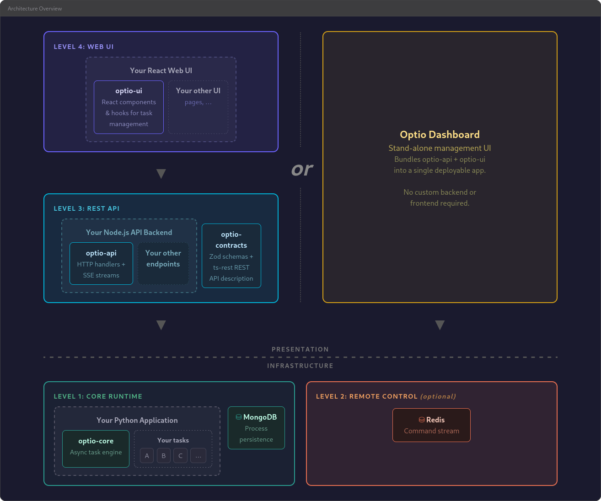

# How to set up a new optio app

This guide builds a complete optio application from an empty directory: a Python
engine, a TypeScript API server and a React frontend. Every step has been carried out
as written. Where the guide says what a command prints, that is what it printed.

The running example is **pressroom**, a small app that "prints" documents. It shows
both ways an optio app does work:

- a **direct engine call**, which answers at once: estimating how many pages a text
  will take;
- an **optio process**, which runs in the background and reports progress: printing.

Replace `pressroom` with your app's name throughout.

## 1. What you will build



An optio app has three layers, plus MongoDB and Redis. (The diagram shows Redis as an
optional "remote control" level of optio. In the app this guide builds it is required:
every call from the API server to the engine goes through it.)

| Layer | Package | Language | Uses | Role |
|---|---|---|---|---|
| Engine | `packages/engine` | Python | `optio-core` | Runs the business logic and the optio processes. **The only writer to MongoDB.** |
| API server | `packages/api` | TypeScript | `optio-api` | Serves data from MongoDB to the frontend. Passes every change to the engine as an RPC call. In production it also serves the built frontend. |
| Frontend | `packages/frontend` | TypeScript | `optio-ui` | The web UI. Talks only to the API server. |

A fourth package, `packages/contracts`, holds the two contracts that connect them:

- **API ↔ frontend:** a [ts-rest](https://ts-rest.com) contract. Both sides import it
  and get typed requests and responses.
- **Engine ↔ API:** a [clamator](https://github.com/deai-network/clamator) contract.
  Clamator is a typed RPC layer over Redis Streams. The contract is written once in Zod,
  and a code generator turns it into a TypeScript client for the API and a Python base
  class for the engine.

### Who writes what

- **The engine is the only writer.** Your domain data and optio's process records are
  written by the engine and nothing else.
- **The API server only reads MongoDB.** For anything that changes state, it calls the
  engine over clamator and returns the engine's answer.
- **The frontend only talks to the API server**, over REST and Server-Sent Events.

### The two ways the engine does work

**A direct call** answers within one request:

```
frontend --REST--> API server --clamator RPC--> engine handler
                                                     |
frontend <--------- API server <-------- result -----+
```

**An optio process** runs in the background, and the UI watches it:

```
frontend (optio-ui) --REST--> optio-api --optio's own RPC--> engine runs the task
                                                                  |
                                                writes progress to MongoDB
                                                                  |
frontend (optio-ui) <--SSE-- optio-api <--- reads/watches MongoDB +
```

Choose a direct call when the answer is ready within a few seconds. Choose an optio
process when the work is long, when the user should see progress or be able to cancel
it, or when it should run on a schedule.

### The app's optio instance: database name + prefix

optio identifies an app's engine by a pair: the **MongoDB database name** and the
**optio prefix**.

- optio's collections are named `<prefix>_processes`, `<prefix>_launch_blocks`, and so
  on, in that database.
- Its Redis keys start with `<database>/<prefix>:`.

**All three layers must use the same pair.** If they differ, the API server's calls to
the engine time out and the UI shows no processes. This guide keeps the pair in one
`.env` file that every layer reads.

Several apps can share one MongoDB server and one Redis, as long as each uses its own
pair. Run exactly one engine per pair.

### Versions this guide was verified with

| Component | Version |
|---|---|
| Node.js | 24.19.0 |
| pnpm | 12.14.0 |
| Python | 3.13.5 |
| Docker Compose | 2.26.1 |
| MongoDB / Redis images | `mongo:7` / `redis:7-alpine` |

## 2. Prerequisites and infrastructure

You need:

- **Node.js 24.** It includes corepack, which installs the pnpm version your repo
  pins.
- **pnpm**, through corepack. If `pnpm` is not on your `PATH`, run
  `corepack enable pnpm` once.
- **Python 3.11 or newer** for the engine.
- **Docker** with the Compose plugin, for MongoDB and Redis. Skip this if you already
  have both running; see below.

### Choose the database name and the prefix

Decide them now. Unless you have a reason not to, use your app's name for both:

```
MONGO_DB=pressroom
OPTIO_PREFIX=pressroom
```

### MongoDB and Redis

Put this `docker-compose.yml` at the root of your repo:

```yaml
# MongoDB (single-node replica set) and Redis for local development.
#
# The replica set lets optio-api watch for changes instead of polling.
# The member is registered as localhost:<port>, so processes on the host can
# connect without directConnection=true. To run on other ports, set
# MONGO_PORT / REDIS_PORT in the environment (or in .env).
services:
  mongodb:
    image: mongo:7
    command: ["--replSet", "rs0", "--bind_ip_all", "--port", "${MONGO_PORT:-27017}"]
    ports:
      - "${MONGO_PORT:-27017}:${MONGO_PORT:-27017}"
    volumes:
      - mongo-data:/data/db
    healthcheck:
      # The first run initiates the replica set; the service is healthy once
      # this node is a writable primary.
      test:
        - CMD-SHELL
        - >-
          mongosh --port ${MONGO_PORT:-27017} --quiet --eval
          "try { rs.status() } catch (e) { rs.initiate({ _id: 'rs0', members: [{ _id: 0, host: 'localhost:${MONGO_PORT:-27017}' }] }) };
          quit(db.hello().isWritablePrimary ? 0 : 1)"
      interval: 2s
      timeout: 10s
      retries: 30
      start_period: 10s

  redis:
    image: redis:7-alpine
    ports:
      - "${REDIS_PORT:-6379}:6379"

volumes:
  mongo-data:
```

Start them, and wait until MongoDB is ready:

```bash
docker compose up -d --wait
```

The command returns once both containers are up and MongoDB is a writable primary,
which takes about ten seconds the first time. To check:

```bash
docker compose exec mongodb mongosh --quiet --eval 'rs.status().members.map(m => m.name + " " + m.stateStr)'
# [ 'localhost:27017 PRIMARY' ]
docker compose exec redis redis-cli ping
# PONG
```

**Why a replica set.** optio-api streams process updates to the browser. On a replica
set it watches MongoDB's change streams. On a standalone server it falls back to
re-reading every second. Everything still works on a standalone server; the replica
set only makes updates cheaper and faster.

**Why `localhost:<port>` as the member name.** A replica-set client connects to the
member names the set reports, not to the address in its URL. The engine and the API
server run on the host, so the member must be reachable from the host under its own
name. A plain `mongodb://localhost:27017` then works, without `directConnection=true`.

**If you already run MongoDB and Redis**, skip the compose file and point `.env` at
them, and leave out the `deps` and `deps-stop` targets of the `Makefile` (section 3).
Use a database name and prefix that no other app uses. To use change streams, the
MongoDB server must be a replica set whose member names are reachable from where your
engine and API server run. Once the engine is installed (section 4), this shows the
member names:

```bash
.venv/bin/python -c "import pymongo; print(pymongo.MongoClient('mongodb://localhost:27017').admin.command('hello')['hosts'])"
# ['localhost:27017']
```

The engine's first start (section 4) is the real check.

## 3. The repo skeleton

The finished repo looks like this:

```
pressroom/
  docker-compose.yml
  Makefile
  package.json
  pnpm-workspace.yaml
  tsconfig.base.json  shared TypeScript settings          (section 5)
  .gitignore
  .env.example        committed
  .env                not committed
  .venv/              the engine's Python environment, not committed
  packages/
    contracts/        clamator and ts-rest contracts             (sections 5, 7)
    engine/           Python, optio-core                         (sections 4, 6)
    api/              TypeScript, Fastify + optio-api            (section 8)
    frontend/         TypeScript, Vite + React + optio-ui        (section 9)
```

This section creates the root files. Each package is added in its own section.

Create the directory and a git repo:

```bash
mkdir pressroom && cd pressroom
git init -b main
mkdir packages
```

`package.json`. The `packageManager` field pins pnpm, and corepack installs that
version on first use:

```json
{
  "name": "pressroom",
  "private": true,
  "type": "module",
  "packageManager": "pnpm@12.14.0",
  "engines": {
    "node": ">=24"
  }
}
```

`pnpm-workspace.yaml`. Only your own packages are listed; optio's packages come from
the npm registry. (To develop optio and your app side by side, see
[Appendix A](#appendix-a-working-on-optio-and-your-app-at-the-same-time).)

```yaml
packages:
  - 'packages/*'
```

The engine package has no `package.json`, so pnpm ignores it.

`.env.example`, committed, and a copy as `.env`, not committed:

```ini
# Read by all three layers: the engine, the API server and the frontend dev
# server. Copy to .env and adjust.

MONGO_URL=mongodb://localhost:27017
# The database name and the optio prefix together identify this app's optio
# instance. All three layers must use the same pair.
MONGO_DB=pressroom
OPTIO_PREFIX=pressroom

REDIS_URL=redis://localhost:6379

API_PORT=3000
```

```bash
cp .env.example .env
```

`.gitignore`:

```
node_modules/
dist/
.venv/
__pycache__/
*.egg-info/
.env
```

`Makefile`. It grows a target or two in each section; it starts with the
infrastructure and the engine's virtual environment:

```make
.PHONY: deps deps-stop venv

PYTHON ?= python3
VENV := .venv

deps:  ## Start MongoDB and Redis, and wait until they are ready
	docker compose up -d --wait

deps-stop:  ## Stop MongoDB and Redis (the data volume is kept)
	docker compose down

venv: $(VENV)/bin/python  ## Create the Python venv for the engine

$(VENV)/bin/python:
	$(PYTHON) -m venv $(VENV)
	$(VENV)/bin/pip install --upgrade pip
```

Install and commit:

```bash
pnpm install    # first run: corepack downloads the pinned pnpm
make venv
git add -A && git commit -m "Skeleton"
```

`pnpm install` has nothing to install yet. It creates `pnpm-lock.yaml`, which you
commit.

## 4. The engine

The engine is a Python package that uses optio-core. It owns the database: it runs
the migrations, defines the tasks, and is the only process that writes.

```
packages/engine/
  pyproject.toml
  src/pressroom_engine/
    __init__.py         empty
    __main__.py         startup: migrations, optio init, run
    config.py           settings from the environment / .env
    tasks.py            the task definitions
    migrations/
      __init__.py       the migration registry
      m001_documents_collection.py
```

### The package

`packages/engine/pyproject.toml`:

```toml
[build-system]
requires = ["setuptools>=68"]
build-backend = "setuptools.build_meta"

[project]
name = "pressroom-engine"
version = "0.1.0"
requires-python = ">=3.11"
dependencies = [
    "optio-core[redis]>=0.6.1,<0.7",
    "mongo-quaestor>=0.1,<0.2",
    "python-dotenv>=1.0",
]

[project.optional-dependencies]
dev = ["watchfiles>=1.0"]

[tool.setuptools.packages.find]
where = ["src"]
```

- **`optio-core[redis]`** brings motor (the async MongoDB driver), clamator and the
  scheduler. The `redis` extra is what lets the API server reach the engine.
  optio-core is at 0.x, where a minor version can break things, so pin the minor
  version.
- **`mongo-quaestor`** is the migration library. optio-core uses it too. It is
  imported as `quaestor`. Do not install the unrelated PyPI package that is
  actually called `quaestor`: the two collide.
- The module is called `pressroom_engine` rather than `engine`, so it cannot clash
  with anything else in the virtual environment.

### Configuration

`src/pressroom_engine/config.py` reads the shared `.env`:

```python
import os
from dataclasses import dataclass

from dotenv import find_dotenv, load_dotenv


@dataclass(frozen=True)
class Config:
    mongo_url: str
    mongo_db: str
    redis_url: str
    optio_prefix: str


def load_config() -> Config:
    # The nearest .env above the working directory. Variables already set in
    # the environment win, so production can do without the file.
    load_dotenv(find_dotenv(usecwd=True))
    return Config(
        mongo_url=os.environ.get("MONGO_URL", "mongodb://localhost:27017"),
        # No defaults: these two must match the API server's, so a missing
        # value is an error rather than a silent mismatch.
        mongo_db=os.environ["MONGO_DB"],
        optio_prefix=os.environ["OPTIO_PREFIX"],
        redis_url=os.environ.get("REDIS_URL", "redis://localhost:6379"),
    )
```

### Migrations

Your app's database changes over time: new collections, new indexes, renamed fields.
Each change is a migration, a small async function that runs once per database.
quaestor keeps a record of the ones already applied.

`src/pressroom_engine/migrations/__init__.py` holds the registry:

```python
from quaestor import MigrationRegistry

migrations = MigrationRegistry()

# Each module registers its migration on import. Add new ones at the end.
from pressroom_engine.migrations import m001_documents_collection  # noqa: E402, F401
```

`src/pressroom_engine/migrations/m001_documents_collection.py` is the first
migration. It creates the collection that section 5 stores documents in:

```python
from pressroom_engine.migrations import migrations


@migrations.register("documents_collection")
async def documents_collection(db):
    if "documents" not in await db.list_collection_names():
        await db.create_collection("documents")
    await db["documents"].create_index([("createdAt", -1)])
```

- A migration is identified by its **name**, the string passed to `register`. Never
  rename or remove one that has been applied anywhere.
- quaestor orders migrations by `depends_on`, and otherwise alphabetically by
  migration name, not by file name. To keep them in the order you write them, make
  each new migration depend on the previous one:
  `@migrations.register("add_titles", depends_on=["documents_collection"])`.
- If a migration raises, the engine stops, and the migration is not recorded. It
  runs again on the next start.

optio-core also has **deferred migrations** (`optio_core.deferred_migrations`). These
run once after the task definitions have been synced, for the rare change that has
to rewrite optio's own process records. You do not need them to start.

### Tasks

`src/pressroom_engine/tasks.py`:

```python
import asyncio

from optio_core import TaskInstance

TEST_PAGE_COUNT = 10


async def print_test_page(ctx) -> None:
    for page in range(1, TEST_PAGE_COUNT + 1):
        if not ctx.should_continue():
            return  # cancelled
        ctx.report_progress(
            100 * (page - 1) / TEST_PAGE_COUNT,
            f"Printing page {page} of {TEST_PAGE_COUNT}",
        )
        await asyncio.sleep(1)
    ctx.report_progress(100, f"Printed {TEST_PAGE_COUNT} pages")


async def get_task_definitions(services, metadata_filter=None) -> list[TaskInstance]:
    # optio drops the tasks that do not match metadata_filter itself, so the
    # filter can be ignored here.
    return [
        TaskInstance(
            execute=print_test_page,
            process_id="print-test-page",
            name="Print a test page",
        ),
    ]
```

- optio calls **`get_task_definitions(services, metadata_filter)`** at startup and
  on every resync. It creates a process record for each new task, updates the
  changed ones and deletes the ones that are gone, cancelling them first if they are
  running.
  Both arguments are passed positionally, so the function must accept two.
- A task's **`execute`** function receives a context. `ctx.report_progress(percent,
  message)` updates the progress bar and writes a log line. `ctx.should_continue()`
  turns `False` once someone cancels; a task that ignores it is force-cancelled after
  a grace period and ends `failed` (section 6). `ctx.services` is the dict passed to `init()`. `ctx.params` and
  `ctx.metadata` come from the `TaskInstance`.
- This first task is fixed. Section 5 adds one task per document, generated from the
  database. Keep at least one task from the start: optio's instance discovery only
  finds an engine whose processes collection has a record in it.

### Startup

`src/pressroom_engine/__main__.py`:

```python
import asyncio
import logging

import optio_core
from motor.motor_asyncio import AsyncIOMotorClient

from pressroom_engine.config import load_config
from pressroom_engine.migrations import migrations
from pressroom_engine.tasks import get_task_definitions

# Applied migrations are recorded in <MIGRATIONS_PREFIX>_migrations. Keep this
# constant: a new value means a new, empty record, and every migration would
# run again.
MIGRATIONS_PREFIX = "pressroom"


async def main() -> None:
    config = load_config()
    client = AsyncIOMotorClient(config.mongo_url, tz_aware=True)
    db = client[config.mongo_db]

    await migrations.run(db, prefix=MIGRATIONS_PREFIX)

    await optio_core.init(
        mongo_db=db,
        prefix=config.optio_prefix,
        redis_url=config.redis_url,
        services={"db": db},
        get_task_definitions=get_task_definitions,
    )
    # The app's own RPC services are registered here, between init() and
    # run(); see section 5.
    await optio_core.run()


if __name__ == "__main__":
    logging.basicConfig(level=logging.INFO)
    asyncio.run(main())
```

- **The order matters:** your migrations, then `init()`, then `run()`. `init()` runs
  optio's own migrations, syncs the task definitions and connects to Redis. `run()`
  starts listening for commands and blocks until the process gets SIGINT or SIGTERM,
  then shuts down cleanly.
- **`tz_aware=True`** makes the driver return timezone-aware datetimes. The generated
  RPC models in section 5 reject naive ones.
- **`services`** is handed to every task as `ctx.services`. Put shared clients in it:
  the database, an HTTP client, and so on.
- The **migrations prefix is a constant**, not `OPTIO_PREFIX` from `.env`. If it
  followed `.env`, changing the prefix would point quaestor at an empty record and
  every migration would run again.

### Install and run

Add to the `Makefile`:

```make
.PHONY: install-engine engine

install-engine: venv  ## Install the engine (editable) and its dev tools
	$(VENV)/bin/pip install -e "packages/engine[dev]"

engine:  ## Run the engine; restart it when its source changes
	$(VENV)/bin/watchfiles --sigint-timeout 15 \
	  "$(VENV)/bin/python -m pressroom_engine" packages/engine/src
```

```bash
make install-engine
make engine
```

`watchfiles` restarts the engine whenever a file under `packages/engine/src` changes.
Some steps change several files in a row (`make install-engine`, `make codegen`, or
adding a few new modules one by one); the engine then restarts several times quickly,
and the log shows `KeyboardInterrupt` tracebacks, or an `ImportError` while a module is
still missing. That is harmless: it settles once every file is in place.
`--sigint-timeout 15` gives the old engine 15 seconds to shut down cleanly before it is
killed. Section 6 explains how long a shutdown can take, and replaces the 15 with a
value derived from the cancel grace period.

The first start prints:

```
INFO:quaestor:[pressroom] 1 migrations to apply: ['documents_collection']
INFO:quaestor:[pressroom] Applying migration: documents_collection
INFO:quaestor:[pressroom] Migration 'documents_collection' applied successfully
INFO:quaestor:[pressroom_fw] 4 migrations to apply: ['status_subdocument', ...]
...
INFO:optio_core_core:Synced 1 task definitions (all)
INFO:quaestor:[pressroom_fw_deferred] All 0 migrations already applied
INFO:optio_core_core:Optio initialized: db='pressroom', prefix='pressroom', redis='redis://localhost:6379'
INFO:optio_core.conversation_archive:conversation archive listening; published http://127.0.0.1:42625/
INFO:optio_core_core:Synced 1 task definitions (all)
```

Later starts print `All 1 migrations already applied`. The `pressroom_fw` lines are
optio's own migrations, kept apart from yours.

The `pressroom` database now has:

| Collection | Written by | Holds |
|---|---|---|
| `documents` | your migration | empty for now |
| `pressroom_migrations` | quaestor | your applied migrations |
| `pressroom_fw_migrations` | optio | optio's applied migrations |
| `pressroom_processes` | optio | one record per task: `print-test-page`, state `idle` |
| `pressroom_engine_endpoints` | optio | where the engine's internal HTTP endpoints listen |

Redis has `pressroom/pressroom:heartbeat`, which the engine refreshes every few
seconds, and `pressroom/pressroom:cmds:optio-engine`, the stream it reads commands
from.

### Test the engine with optio-dashboard

You do not need the API server and the frontend to try the engine.
[optio-dashboard](../packages/optio-dashboard) is a ready-made optio-api server and
optio-ui frontend in one package. Point it at your database and prefix, and you can
launch, watch and cancel every task:

```bash
MONGODB_URL=mongodb://localhost:27017/pressroom \
OPTIO_PREFIX=pressroom \
REDIS_URL=redis://localhost:6379 \
OPTIO_PASSWORD=choose-a-password \
PORT=3999 \
npx -y optio-dashboard
```

Open exactly `http://localhost:3999` (on a remote machine, through a tunnel:
`ssh -L 3999:localhost:3999 <machine>`): sign-in checks the address, and
`http://127.0.0.1:3999` or a machine name fails with "Invalid origin". Sign in with the
password, and the header shows
`pressroom/pressroom`. Click the play icon next to "Print a test page": the progress
bar fills over ten seconds, and the log fills in live.

- **Put the database name in `MONGODB_URL`.** With a database in the path, the
  dashboard looks only at that database. Without one, it lists every optio instance on
  the whole MongoDB server, and picks the first live one. On a server shared with other
  apps, that may not be yours.
- **Set `OPTIO_PREFIX`**, so only your prefix is listed.
- `OPTIO_PASSWORD` is required. The dashboard keeps its login data in the database
  from `MONGODB_URL`, in the collections `user`, `account` and `session`. Without a
  database in the URL, it uses a database called `optio`.
- npm prints peer-dependency warnings while installing it, and at startup it warns
  about a Fastify deprecation and that `@fastify/reply-from might not behave as
  expected when used with @fastify/multipart`. All harmless.
- The dashboard listens on every network interface, not only localhost.
- A few of its filter labels show as keys (`processes.search`, …): that is the
  dashboard's own omission, not your app's.

What the dashboard cannot test is your app's own engine calls: the direct calls of
section 5 need your own API server.

## 5. The engine ↔ API contract

For the direct calls, the API server calls methods on the engine over clamator. You
describe those methods once, in TypeScript with Zod, and a code generator produces:

- a typed **TypeScript client** that the API server uses;
- **Python models and an abstract service class** that the engine implements.

The contract lives in `packages/contracts`, next to the API ↔ frontend contract of
section 7.

### The contracts package

`tsconfig.base.json` at the repo root, shared by every TypeScript package:

```json
{
  "compilerOptions": {
    "target": "ES2023",
    "module": "nodenext",
    "moduleResolution": "nodenext",
    "strict": true,
    "skipLibCheck": true,
    "isolatedModules": true,
    "declaration": true
  }
}
```

`packages/contracts/package.json`:

```json
{
  "name": "@pressroom/contracts",
  "version": "0.1.0",
  "private": true,
  "type": "module",
  "exports": {
    ".": {
      "types": "./dist/index.d.ts",
      "default": "./dist/index.js"
    },
    "./engine": {
      "types": "./dist/engine-contract.d.ts",
      "default": "./dist/engine-contract.js"
    }
  },
  "scripts": {
    "build": "tsc -p tsconfig.json"
  },
  "dependencies": {
    "@clamator/protocol": "0.1.9",
    "zod": "^3.25.0"
  },
  "devDependencies": {
    "typescript": "^7.0.2"
  }
}
```

- The **`./engine` subpath** is what the generated TypeScript client imports.
- **clamator is pre-1.0 and released in lockstep**: every `@clamator/*` npm package
  and every `clamator-*` PyPI package carries the same version. Pin it exactly, and
  bump all of them together.
- **zod must be version 3.** clamator's packages require `zod ^3.23`.

`packages/contracts/tsconfig.json`:

```json
{
  "extends": "../../tsconfig.base.json",
  "compilerOptions": {
    "rootDir": "src",
    "outDir": "dist"
  },
  "include": ["src"]
}
```

`packages/contracts/src/schemas.ts` holds the data shapes that both contracts use:

```ts
import { z } from 'zod';

export const DocumentSchema = z.object({
  id: z.string(),
  title: z.string(),
  text: z.string(),
  createdAt: z.string().datetime({ offset: true }),
  lastPrintedAt: z.string().datetime({ offset: true }).nullable(),
});
export type Document = z.infer<typeof DocumentSchema>;

export const NewDocumentSchema = z.object({
  title: z.string().min(1),
  text: z.string(),
});
export type NewDocument = z.infer<typeof NewDocumentSchema>;

export const CreateDocumentFailureReason = z.enum(['empty-text']);
export type CreateDocumentFailureReason = z.infer<typeof CreateDocumentFailureReason>;
```

The failure reasons live here rather than in the engine contract, so the frontend can
import them without pulling clamator into the browser bundle.

`packages/contracts/src/engine-contract.ts` is the contract itself:

```ts
import { z } from 'zod';
import { defineContract, defineMethod } from '@clamator/protocol';

import { CreateDocumentFailureReason, DocumentSchema, NewDocumentSchema } from './schemas.js';

// The engine's own RPC methods, called by the API server. The export must be
// named after the service: pressroom-engine -> pressroomEngineContract. The
// generated client imports it by that name.
export const pressroomEngineContract = defineContract('pressroom-engine', {
  estimatePages: defineMethod({
    params: z.object({ text: z.string() }),
    result: z.object({ pages: z.number().int() }),
  }),
  createDocument: defineMethod({
    params: NewDocumentSchema,
    result: z.discriminatedUnion('ok', [
      z.object({ ok: z.literal(true), document: DocumentSchema }),
      z.object({ ok: z.literal(false), reason: CreateDocumentFailureReason }),
    ]),
  }),
});
```

- **The service name** (`pressroom-engine`) must not be `optio-engine`: optio's own
  service already uses that name on the same RPC server.
- **The export name must be the service name in camelCase plus `Contract`.** The
  generated client imports `pressroomEngineContract` from `@pressroom/contracts/engine`
  whatever you called it.
- **Put contract files directly in `src/`**, not in a subdirectory. The code generator
  only looks at the top level.
- **Expected failures are part of the result**, as a union on `ok` with a `reason`
  enum. The API server turns each reason into an HTTP status. Use exceptions only
  for the unexpected.

`packages/contracts/src/index.ts`:

```ts
export * from './schemas.js';
```

### Code generation

Add the code generator at the repo root, in `package.json`:

```json
  "devDependencies": {
    "@clamator/codegen": "0.1.9",
    "zod": "^3.25.0"
  }
```

`zod` is listed here as well because `@clamator/codegen` needs a zod. Without one at
the root, pnpm gives it zod 4, which does not match the zod 3 your contracts are
written with.

The generator loads your contract files with `tsx`, which brings in esbuild. pnpm
does not run a dependency's install script unless you allow it, and fails the install
instead (`ERR_PNPM_IGNORED_BUILDS`). Allow esbuild's in `pnpm-workspace.yaml`:

```yaml
packages:
  - 'packages/*'

# pnpm refuses to run dependencies' install scripts unless they are allowed.
# esbuild (used by @clamator/codegen through tsx) needs its script.
allowBuilds:
  esbuild: true
```

The Python half of the generator calls `datamodel-codegen`, so add it to the engine's
dev tools. The generated module imports clamator directly, so list clamator among the
engine's dependencies too. In `packages/engine/pyproject.toml`:

```toml
dependencies = [
    "optio-core[redis]>=0.6.1,<0.7",
    "mongo-quaestor>=0.1,<0.2",
    "clamator-protocol>=0.1.9,<0.2",
    "clamator-over-redis>=0.1.9,<0.2",
    "python-dotenv>=1.0",
]

[project.optional-dependencies]
dev = ["watchfiles>=1.0", "datamodel-code-generator>=0.26"]
```

Add to the `Makefile`:

```make
.PHONY: contracts codegen verify-codegen

contracts:  ## Build the contracts package (the API server and frontend import its dist/)
	pnpm --filter @pressroom/contracts build

GEN_TS := packages/api/src/_generated
GEN_PY := packages/engine/src/pressroom_engine/_generated

codegen:  ## Regenerate the engine RPC client (TS) and service base class (Python)
	PATH="$(CURDIR)/$(VENV)/bin:$$PATH" pnpm exec clamator-codegen \
	  --src packages/contracts/src \
	  --out-ts $(GEN_TS) \
	  --out-py $(GEN_PY) \
	  --ts-contract-import '@pressroom/contracts/engine'
	# Python cannot import a module whose name has a hyphen.
	mv $(GEN_PY)/pressroom-engine.py $(GEN_PY)/pressroom_engine.py

verify-codegen: codegen  ## Fail if the committed generated code is out of date
	@test -z "$$(git status --porcelain -- $(GEN_TS) $(GEN_PY))" || \
	  { git status --short -- $(GEN_TS) $(GEN_PY); echo "Generated code is out of date: commit the output of make codegen"; exit 1; }
```

Install and generate:

```bash
pnpm install
make install-engine
make contracts
make codegen
```

This writes two files, one per service. Commit both:

- `packages/api/src/_generated/pressroom-engine.ts`, with a `PressroomEngineClient`
  class: one method per contract method, each taking an optional `{ timeoutMs }`
  (the default is 30 seconds).
- `packages/engine/src/pressroom_engine/_generated/pressroom_engine.py`, with:
  - one pydantic model per params and result. Fields are snake_case in Python and
    camelCase on the wire (`created_at: AwareDatetime = Field(..., alias="createdAt")`).
    The models forbid extra fields.
  - a union result as a `RootModel` over numbered variants: `CreateDocumentResult`
    wraps `CreateDocumentResult1` (`ok: true`) and `CreateDocumentResult2`
    (`ok: false`).
  - `PressroomEngineService`, an abstract class with one `async` method per contract
    method, in snake_case (`create_document`).
  - `pressroom_engine_contract`, the object you register on the RPC server.

**Whenever the contract changes:** run `make contracts codegen`, implement any new
method in the engine, and commit the regenerated files with the contract change. Run
`make verify-codegen` in CI: it regenerates and fails if the result differs from what
is committed.

### Implement the service in the engine

`packages/engine/src/pressroom_engine/documents.py`, the domain code that the
service and the tasks share:

```python
import math

WORDS_PER_PAGE = 300


def estimate_pages(text: str) -> int:
    return math.ceil(len(text.split()) / WORDS_PER_PAGE)


def document_out(doc: dict) -> dict:
    """A record of the documents collection, in the contract's Document shape."""
    return {
        "id": str(doc["_id"]),
        "title": doc["title"],
        "text": doc["text"],
        "createdAt": doc["createdAt"],
        "lastPrintedAt": doc.get("lastPrintedAt"),
    }
```

`packages/engine/src/pressroom_engine/rpc.py`:

```python
from datetime import datetime, timezone

import optio_core

from pressroom_engine._generated import pressroom_engine as generated
from pressroom_engine._generated.pressroom_engine import (
    CreateDocumentParams,
    CreateDocumentResult,
    EstimatePagesParams,
    EstimatePagesResult,
)
from pressroom_engine.documents import document_out, estimate_pages


class PressroomEngineService(generated.PressroomEngineService):
    """The engine's own RPC methods. Registered in __main__.py."""

    def __init__(self, db):
        self._db = db

    async def estimate_pages(self, params: EstimatePagesParams) -> EstimatePagesResult:
        return EstimatePagesResult(pages=estimate_pages(params.text))

    async def create_document(self, params: CreateDocumentParams) -> CreateDocumentResult:
        if not params.text.strip():
            return CreateDocumentResult.model_validate({"ok": False, "reason": "empty-text"})
        doc = {
            "title": params.title,
            "text": params.text,
            "createdAt": datetime.now(timezone.utc),
            "lastPrintedAt": None,
        }
        result = await self._db["documents"].insert_one(doc)
        # A new document gets a print task. Resync just that one.
        await optio_core.resync(metadata_filter={"documentId": str(result.inserted_id)})
        return CreateDocumentResult.model_validate({"ok": True, "document": document_out(doc)})
```

- **Params arrive validated**, as the generated model. A call whose params do not
  match the contract never reaches your method; the caller gets an "Invalid params"
  error.
- **Results are validated too.** Return the generated result model, or anything that
  validates against it. `model_validate` on a dict in the wire shape (camelCase keys)
  is the easy way to build a union result. If the result does not match the contract,
  the caller gets a "Result validation failed" error, and the engine logs the details.
- **Writes happen here**, in the engine. `create_document` stores the document and then
  calls `optio_core.resync` with a metadata filter. That regenerates only the tasks
  whose metadata matches, which here is the new document's print task.

Register the service in `__main__.py`, between `init()` and `run()`:

```python
from pressroom_engine._generated.pressroom_engine import pressroom_engine_contract
from pressroom_engine.rpc import PressroomEngineService

...
    await optio_core.init(...)
    # The app's own RPC methods share optio's RPC server. Register them after
    # init(), which creates the server, and before run(), which starts it.
    optio_core.rpc_server.register_service(pressroom_engine_contract, PressroomEngineService(db))
    await optio_core.run()
```

Your methods share optio's RPC server, and with it the Redis key prefix
`<database>/<prefix>`. The API server reaches both optio's methods and yours over one
connection (section 8).

### Tasks generated from data

Now each document gets its own print task. The new `tasks.py`:

```python
import asyncio
from datetime import datetime, timezone

from bson import ObjectId
from optio_core import TaskInstance

from pressroom_engine.documents import estimate_pages

TEST_PAGE_COUNT = 10


async def print_pages(ctx, pages: int) -> bool:
    """Print page by page. Returns False if cancelled."""
    for page in range(1, pages + 1):
        if not ctx.should_continue():
            return False
        ctx.report_progress(100 * (page - 1) / pages, f"Printing page {page} of {pages}")
        await asyncio.sleep(1)
    ctx.report_progress(100, f"Printed {pages} pages")
    return True


async def print_test_page(ctx) -> None:
    await print_pages(ctx, TEST_PAGE_COUNT)


async def print_document(ctx) -> None:
    db = ctx.services["db"]
    doc = await db["documents"].find_one({"_id": ObjectId(ctx.params["documentId"])})
    if doc is None:
        raise RuntimeError(f"Document {ctx.params['documentId']} not found")
    if await print_pages(ctx, estimate_pages(doc["text"])):
        await db["documents"].update_one(
            {"_id": doc["_id"]},
            {"$set": {"lastPrintedAt": datetime.now(timezone.utc)}},
        )


async def get_task_definitions(services, metadata_filter=None) -> list[TaskInstance]:
    # optio drops the tasks that do not match metadata_filter itself, so the
    # filter can be ignored here.
    tasks = [
        TaskInstance(
            execute=print_test_page,
            process_id="print-test-page",
            name="Print a test page",
        ),
    ]
    async for doc in services["db"]["documents"].find({}, {"title": 1}).sort("createdAt", 1):
        doc_id = str(doc["_id"])
        tasks.append(
            TaskInstance(
                execute=print_document,
                process_id=f"print-{doc_id}",
                name=f'Print "{doc["title"]}"',
                params={"documentId": doc_id},
                metadata={"documentId": doc_id, "kind": "print"},
            )
        )
    return tasks
```

- **`params`** are for the task itself. **`metadata`** is for finding the task:
  resyncing it, filtering the process list in the UI, scoping access in the API
  server. Here both carry the document id, and `kind` tells a document's processes
  apart (section 10 adds a second kind).
- **A task writes through the engine like everything else.** `print_document` sets
  `lastPrintedAt` on its document when it finishes.
- A task that raises ends in the `failed` state, and the exception message is stored
  on the process as its error.

### Try it from Python

The engine restarts by itself (`make engine`). Before the API server exists, you can
call it with the generated Python client. Save this as `try_engine.py` at the repo root
and run it with the venv's Python, `.venv/bin/python try_engine.py`:

```python
import asyncio
from clamator_over_redis import RedisRpcClient
from pressroom_engine._generated.pressroom_engine import (
    PressroomEngineClient, EstimatePagesParams, CreateDocumentParams)

async def main():
    # key_prefix: <MONGO_DB>/<OPTIO_PREFIX> from your .env
    rpc = RedisRpcClient(redis_url="redis://localhost:6379", key_prefix="pressroom/pressroom")
    await rpc.start()
    engine = PressroomEngineClient(rpc)
    text = " ".join(["word"] * 1000)
    print(await engine.estimate_pages(EstimatePagesParams(text=text)))
    print(await engine.create_document(CreateDocumentParams(title="Empty", text="   ")))
    print(await engine.create_document(CreateDocumentParams(title="Annual report", text=text)))
    await rpc.stop()

asyncio.run(main())
```

```
pages=4
root=CreateDocumentResult2(ok=False, reason='empty-text')
root=CreateDocumentResult1(ok=True, document=Document(id='6ad2ece27f94af7380fe9b61', title='Annual report', text='word word word ...', ...))
```

After `create_document`, the engine logs `Synced 1 task definitions (filter=
{'documentId': '…'})`: the targeted resync. The new document's `Print "Annual report"`
process is now in `pressroom_processes`. Launched (from optio-dashboard, for example),
it prints 4 pages and sets the document's `lastPrintedAt`.

## 6. Cancellation, shutdown and restarts

A running process can be stopped in three ways:

- **someone cancels it**, from the UI or the API;
- **the engine shuts down**: Ctrl-C in development, SIGTERM from a deployment;
- **the engine dies**: a crash, SIGKILL, a power cut.

This section shows what optio does in each case, what your tasks must do, and how to
size the timeouts. Every timing below was measured on pressroom, with a grace period
of 10 seconds.

### Cancelling a process

1. The process goes to `cancel_requested`, then `cancelling`, and
   `ctx.should_continue()` starts returning `False`. Nothing is interrupted: optio
   waits for the task to notice.
2. **A task that returns now ends `cancelled`.** Pressroom's print notices within a
   second, so its cancels completed 0.6 to 1.1 seconds after the request.
3. **A task that is still running when the grace period ends** (`cancel_grace_seconds`,
   optio's default is 5) gets a `CancelledError` thrown into it at its next `await`.
4. If it has still not ended 2 seconds later, optio records it as **`failed`**, with
   the error "Task did not unwind within cancellation grace period". A test task that
   ignored the cancel ended that way 11.0 seconds after the request.

Children are cancelled along with their parent. A task declared with
`cancellable=False` refuses a user's cancel, but an engine shutdown stops it all the
same.

### Writing tasks that stop well

- **Check `ctx.should_continue()` often**, between steps, at least every second or so.
  When you wait on something long, race the wait against `ctx.cancellation_flag`, an
  `asyncio.Event` that is set on cancel.
- **Clean up in `try`/`finally`.** It runs when the task returns after a cancel, and
  also when optio throws `CancelledError` into it.
- **Never block the event loop.** A long synchronous call freezes the whole engine:
  cancels, RPC calls, the heartbeat (the UI shows the engine as offline) and shutdown.
  Use async libraries. `asyncio.to_thread` keeps the loop free, but a thread cannot be
  interrupted, and the engine waits for it before it exits.
- **optio never kills your subprocesses.** If a task runs a command (a typesetter, a
  converter), it has to stop the command itself. This helper does that: it runs the
  command in its own process group and, if the task is told to stop, sends that group
  SIGTERM, then SIGKILL after 5 seconds. Pressroom uses it from section 10 on, for
  LuaLaTeX; it lives in `src/pressroom_engine/commands.py`, which you create there:

  ```python
  import asyncio
  import os
  import signal


  async def run_command(ctx, *argv: str, **kwargs) -> int | None:
      """Run a command. If the task is told to stop, stop the command and
      everything it started. Returns the exit code, or None if stopped.
      kwargs go to asyncio.create_subprocess_exec (cwd, stdout, ...)."""
      # Its own process group, so that killing it reaches its children too.
      proc = await asyncio.create_subprocess_exec(*argv, start_new_session=True, **kwargs)
      finished = asyncio.ensure_future(proc.wait())
      stopped = asyncio.ensure_future(ctx.cancellation_flag.wait())
      try:
          await asyncio.wait({finished, stopped}, return_when=asyncio.FIRST_COMPLETED)
      finally:
          stopped.cancel()
          if proc.returncode is None:
              os.killpg(proc.pid, signal.SIGTERM)
              try:
                  await asyncio.wait_for(asyncio.shield(finished), 5)
              except TimeoutError:
                  os.killpg(proc.pid, signal.SIGKILL)
                  await finished
      return None if stopped.done() and not stopped.cancelled() else proc.returncode
  ```

  Tested with `sleep 600`: on cancel, the command was gone and the task `cancelled`
  0.6 seconds later. With a command that ignores SIGTERM, the SIGKILL came after 5
  seconds, and the task ended `cancelled` 5.6 seconds after the request, within the
  grace period.

### Shutting down the engine

On SIGINT or SIGTERM, `optio_core.run()` shuts the engine down:

1. New launches and RPC calls are refused.
2. Every running process is told to stop, as if cancelled. (There is no
   `cancel_requested` step: a task that returns goes straight to `cancelled`.)
3. optio waits for them, for up to the grace period plus 5 seconds.
4. Whatever is still running is force-cancelled, one process at a time, and ends
   `failed`.
5. `run()` returns.

With a task that ignored the stop, pressroom's engine exited 15.9 seconds after Ctrl-C:
10 seconds of grace, 5 of margin, then the force-cancel.

**How long a shutdown can take:** about 2 × grace + 10 seconds when RPC calls are in
flight, plus about 2 seconds for each task that has to be force-cancelled, plus your
own cleanup after `run()` returns. Whatever stops the engine must wait at least that
long before it kills it. Excavator's rule, used here too, is
**2 × grace + 60 seconds**. In development that is watchfiles' `--sigint-timeout`; in
production, the container's stop timeout (section 12).

**Press Ctrl-C once, and wait for `Shutdown complete`.** After it, a traceback
(`Exception ignored in atexit callback … KeyboardInterrupt`) and
`make: *** [Makefile:…: engine] Interrupt` are normal. The engine ignores a second
Ctrl-C. Under `make engine`, though, the second one kills watchfiles and make, and your
prompt returns while the engine is still shutting down in the background.

Make the grace period a setting. Add these lines to `.env.example`, and the same lines
to your `.env` (it was copied in section 3, before they existed):

```ini
# How long a task may take to stop after a cancel or an engine shutdown before
# optio force-cancels it, in whole seconds. The engine's stop timeout in the
# Makefile is derived from it (2 x grace + 60).
CANCEL_GRACE_SECONDS=10
# After a graceful engine restart, resumable processes continue by themselves
# after this many seconds (optio's default is 300).
AUTO_RESUME_DELAY_SECONDS=30
```

In `config.py`, two more fields:

```python
@dataclass(frozen=True)
class Config:
    mongo_url: str
    mongo_db: str
    redis_url: str
    optio_prefix: str
    cancel_grace_seconds: float
    auto_resume_delay_seconds: float


def load_config() -> Config:
    ...
    return Config(
        ...
        # optio's defaults are 5 and 300.
        cancel_grace_seconds=float(os.environ.get("CANCEL_GRACE_SECONDS", 5)),
        auto_resume_delay_seconds=float(os.environ.get("AUTO_RESUME_DELAY_SECONDS", 300)),
    )
```

In `__main__.py`, pass them to `init()`:

```python
    await optio_core.init(
        mongo_db=db,
        prefix=config.optio_prefix,
        redis_url=config.redis_url,
        services={"db": db},
        get_task_definitions=get_task_definitions,
        cancel_grace_seconds=config.cancel_grace_seconds,
        auto_resume_delay_seconds=config.auto_resume_delay_seconds,
    )
```

And derive the stop timeout in the `Makefile`, replacing the fixed 15 of section 4:

```make
# The engine's stop budget (section 6): 2 x the cancel grace + 60 seconds.
# The grace comes from the environment or .env, default 5 (optio's).
CANCEL_GRACE_SECONDS ?= $(shell sed -n 's/^CANCEL_GRACE_SECONDS=//p' .env 2>/dev/null | tail -1)
ENGINE_STOP_TIMEOUT := $(shell echo $$(( 2 * $(or $(CANCEL_GRACE_SECONDS),5) + 60 )))

engine:  ## Run the engine; restart it when its source changes
	$(VENV)/bin/watchfiles --sigint-timeout $(ENGINE_STOP_TIMEOUT) \
	  "$(VENV)/bin/python -m pressroom_engine" packages/engine/src
```

With a grace of 10, `make -n engine` shows `--sigint-timeout 80`. A running
`make engine` still has the old timeout and the old settings: stop it (Ctrl-C once) and
start it again.

The API server holds nothing that needs saving. Its `index.ts` (section 8) closes
the server on SIGINT or SIGTERM and exits; with a live event stream open, it stopped
listening 36 milliseconds after Ctrl-C.

### Restarts, and resuming where a task left off

**After a crash**, the processes that were running stay marked as running until the
engine starts again. At startup it marks each of them `failed`, with the error
"Process was interrupted by server restart", and logs
`State reconciled: running -> failed (server restart)`.

**A task can instead pick up where it stopped**, if it declares that it can and keeps
a record of how far it got:

- `supports_resume=True` on the `TaskInstance`. A launch with `resume` then tells the
  task so: `ctx.resume` is `True`.
- `await ctx.mark_has_saved_state()` once there is something to resume from, and
  `await ctx.clear_has_saved_state()` when the work is complete. The saved state itself
  is yours: keep it in your own collections.
- **Save as you go**, not only when told to stop. A crash gives the task no chance to
  save anything.

Here is pressroom's print, now resumable. It records the next page on the document
after every page:

```python
async def print_document(ctx) -> None:
    documents = ctx.services["db"]["documents"]
    doc = await documents.find_one({"_id": ObjectId(ctx.params["documentId"])})
    if doc is None:
        raise RuntimeError(f"Document {ctx.params['documentId']} not found")
    pages = estimate_pages(doc["text"])
    # A resume continues where the previous run got to; a launch starts over.
    first = doc.get("nextPage", 1) if ctx.resume else 1
    # From here on there is always a checkpoint to resume from.
    await ctx.mark_has_saved_state()
    for page in range(first, pages + 1):
        if not ctx.should_continue():
            return  # cancelled, or the engine is shutting down
        ctx.report_progress(100 * (page - 1) / pages, f"Printing page {page} of {pages}")
        await asyncio.sleep(1)
        # Checkpoint after every page, so that a resume (even after a crash)
        # continues with the next one.
        await documents.update_one({"_id": doc["_id"]}, {"$set": {"nextPage": page + 1}})
    ctx.report_progress(100, f"Printed {pages} pages")
    await documents.update_one(
        {"_id": doc["_id"]},
        {"$set": {"lastPrintedAt": datetime.now(timezone.utc)}, "$unset": {"nextPage": ""}},
    )
    await ctx.clear_has_saved_state()
```

and its task definition gains two flags:

```python
            TaskInstance(
                execute=print_document,
                process_id=f"print-{doc_id}",
                name=f'Print "{doc["title"]}"',
                params={"documentId": doc_id},
                metadata={"documentId": doc_id, "kind": "print"},
                # Can continue from a saved page, and does so by itself
                # after the engine restarts.
                supports_resume=True,
                auto_resume=True,
            )
```

`print_pages`, the helper of section 5, goes; `print_test_page` gets its own loop
again. The whole `tasks.py` now:

```python
import asyncio
from datetime import datetime, timezone

from bson import ObjectId
from optio_core import TaskInstance

from pressroom_engine.documents import estimate_pages

TEST_PAGE_COUNT = 10


async def print_test_page(ctx) -> None:
    for page in range(1, TEST_PAGE_COUNT + 1):
        if not ctx.should_continue():
            return
        ctx.report_progress(100 * (page - 1) / TEST_PAGE_COUNT, f"Printing page {page} of {TEST_PAGE_COUNT}")
        await asyncio.sleep(1)
    ctx.report_progress(100, f"Printed {TEST_PAGE_COUNT} pages")


async def print_document(ctx) -> None:
    documents = ctx.services["db"]["documents"]
    doc = await documents.find_one({"_id": ObjectId(ctx.params["documentId"])})
    if doc is None:
        raise RuntimeError(f"Document {ctx.params['documentId']} not found")
    pages = estimate_pages(doc["text"])
    # A resume continues where the previous run got to; a launch starts over.
    first = doc.get("nextPage", 1) if ctx.resume else 1
    # From here on there is always a checkpoint to resume from.
    await ctx.mark_has_saved_state()
    for page in range(first, pages + 1):
        if not ctx.should_continue():
            return  # cancelled, or the engine is shutting down
        ctx.report_progress(100 * (page - 1) / pages, f"Printing page {page} of {pages}")
        await asyncio.sleep(1)
        # Checkpoint after every page, so that a resume (even after a crash)
        # continues with the next one.
        await documents.update_one({"_id": doc["_id"]}, {"$set": {"nextPage": page + 1}})
    ctx.report_progress(100, f"Printed {pages} pages")
    await documents.update_one(
        {"_id": doc["_id"]},
        {"$set": {"lastPrintedAt": datetime.now(timezone.utc)}, "$unset": {"nextPage": ""}},
    )
    await ctx.clear_has_saved_state()


async def get_task_definitions(services, metadata_filter=None) -> list[TaskInstance]:
    # optio drops the tasks that do not match metadata_filter itself, so the
    # filter can be ignored here.
    tasks = [
        TaskInstance(
            execute=print_test_page,
            process_id="print-test-page",
            name="Print a test page",
        ),
    ]
    async for doc in services["db"]["documents"].find({}, {"title": 1}).sort("createdAt", 1):
        doc_id = str(doc["_id"])
        tasks.append(
            TaskInstance(
                execute=print_document,
                process_id=f"print-{doc_id}",
                name=f'Print "{doc["title"]}"',
                params={"documentId": doc_id},
                metadata={"documentId": doc_id, "kind": "print"},
                # Can continue from a saved page, and does so by itself
                # after the engine restarts.
                supports_resume=True,
                auto_resume=True,
            )
        )
    return tasks
```

And the whole `config.py` and `__main__.py`, after this section:

```python
import os
from dataclasses import dataclass

from dotenv import find_dotenv, load_dotenv


@dataclass(frozen=True)
class Config:
    mongo_url: str
    mongo_db: str
    redis_url: str
    optio_prefix: str
    cancel_grace_seconds: float
    auto_resume_delay_seconds: float


def load_config() -> Config:
    # The nearest .env above the working directory. Variables already set in
    # the environment win, so production can do without the file.
    load_dotenv(find_dotenv(usecwd=True))
    return Config(
        mongo_url=os.environ.get("MONGO_URL", "mongodb://localhost:27017"),
        # No defaults: these two must match the API server's, so a missing
        # value is an error rather than a silent mismatch.
        mongo_db=os.environ["MONGO_DB"],
        optio_prefix=os.environ["OPTIO_PREFIX"],
        redis_url=os.environ.get("REDIS_URL", "redis://localhost:6379"),
        # optio's defaults are 5 and 300.
        cancel_grace_seconds=float(os.environ.get("CANCEL_GRACE_SECONDS", 5)),
        auto_resume_delay_seconds=float(os.environ.get("AUTO_RESUME_DELAY_SECONDS", 300)),
    )
```

```python
import asyncio
import logging

import optio_core
from motor.motor_asyncio import AsyncIOMotorClient

from pressroom_engine._generated.pressroom_engine import pressroom_engine_contract
from pressroom_engine.config import load_config
from pressroom_engine.migrations import migrations
from pressroom_engine.rpc import PressroomEngineService
from pressroom_engine.tasks import get_task_definitions

# Applied migrations are recorded in <MIGRATIONS_PREFIX>_migrations. Keep this
# constant: a new value means a new, empty record, and every migration would
# run again.
MIGRATIONS_PREFIX = "pressroom"


async def main() -> None:
    config = load_config()
    client = AsyncIOMotorClient(config.mongo_url, tz_aware=True)
    db = client[config.mongo_db]

    await migrations.run(db, prefix=MIGRATIONS_PREFIX)

    await optio_core.init(
        mongo_db=db,
        prefix=config.optio_prefix,
        redis_url=config.redis_url,
        services={"db": db},
        get_task_definitions=get_task_definitions,
        cancel_grace_seconds=config.cancel_grace_seconds,
        auto_resume_delay_seconds=config.auto_resume_delay_seconds,
    )
    # The app's own RPC methods share optio's RPC server. Register them after
    # init(), which creates the server, and before run(), which starts it.
    optio_core.rpc_server.register_service(pressroom_engine_contract, PressroomEngineService(db))
    await optio_core.run()


if __name__ == "__main__":
    logging.basicConfig(level=logging.INFO)
    asyncio.run(main())
```

**Resuming by hand.** optio-ui's standard process components show it without any code
of yours. For a process with saved state, the play button becomes **Resume**, and its
menu offers **Restart (discard saved state)**. Over the API, it is a launch with
`{"resume": true}`. A 20-page print that was SIGKILLed on page 7 came back after the
restart as `failed`; Resume in optio-dashboard continued with "Printing page 7 of 20"
and finished.

**Resuming by itself** is `auto_resume=True` (it requires `supports_resume`). When the
engine shuts down gracefully, it marks such processes; after the next start, and after
`auto_resume_delay_seconds`, it resumes them. A print stopped by Ctrl-C on page 9
continued with page 10, 31 seconds after the engine came back (delay 30). After a
crash nothing is resumed automatically, because the engine never got to mark the
processes: use Resume.

Only top-level processes are auto-resumed, not children.

## 7. The API ↔ frontend contract

The frontend talks to two sets of routes on the API server: optio's own (process list,
launch, cancel, live updates), which optio-api and optio-ui already agree on, and your
app's. For your app's routes you write a [ts-rest](https://ts-rest.com) contract: a
plain TypeScript object that lists each route's method, path, body and responses as Zod
schemas. The API server implements it (section 8), and the frontend gets a typed client
from it (section 9).

No code generation is involved. Both sides import the built contracts package.

### One router per resource

Add ts-rest to `packages/contracts/package.json`:

```json
  "dependencies": {
    "@clamator/protocol": "0.1.9",
    "@ts-rest/core": "^3.52.1",
    "zod": "^3.25.0"
  },
```

Add the error body to `src/schemas.ts`:

```ts
// The body of every error response from the API server, as in optio-api.
export const ErrorSchema = z.object({
  reason: z.string(),
  message: z.string(),
});
```

`src/api/config.ts`:

```ts
import { initContract } from '@ts-rest/core';
import { z } from 'zod';

const c = initContract();

export const configContract = c.router({
  // Which optio instance the frontend shows: the same database name and
  // prefix the engine uses.
  get: {
    method: 'GET',
    path: '/config',
    responses: {
      200: z.object({ mongoDb: z.string(), optioPrefix: z.string() }),
    },
  },
});
```

`src/api/documents.ts`:

```ts
import { initContract } from '@ts-rest/core';
import { z } from 'zod';

import {
  CreateDocumentFailureReason,
  DocumentSchema,
  ErrorSchema,
  NewDocumentSchema,
} from '../schemas.js';

const c = initContract();

export const documentsContract = c.router({
  list: {
    method: 'GET',
    path: '/documents',
    responses: {
      200: z.array(DocumentSchema),
    },
    summary: 'All documents, newest first',
  },
  create: {
    method: 'POST',
    path: '/documents',
    body: NewDocumentSchema,
    responses: {
      201: DocumentSchema,
      400: ErrorSchema.extend({ reason: CreateDocumentFailureReason }),
    },
  },
  estimatePages: {
    method: 'POST',
    path: '/documents/estimate-pages',
    body: z.object({ text: z.string() }),
    responses: {
      200: z.object({ pages: z.number().int() }),
    },
  },
});
```

`src/api-contract.ts` puts them together:

```ts
import { initContract } from '@ts-rest/core';

import { configContract } from './api/config.js';
import { documentsContract } from './api/documents.js';

const c = initContract();

// The REST API between the API server and the frontend. One router per
// resource, in src/api/.
export const apiContract = c.router(
  {
    config: configContract,
    documents: documentsContract,
  },
  { pathPrefix: '/api' },
);
```

`src/index.ts` exports it:

```ts
export * from './schemas.js';
export { apiContract } from './api-contract.js';
```

- **Every route is under `/api`**, like optio-api's. In development the frontend's dev
  server forwards `/api` to the API server; in production the API server serves the
  frontend from the same origin (sections 9 and 12).
- **`GET /api/config` tells the frontend which optio instance to show.** optio-ui needs
  the database name and the prefix. Its fallbacks are a prefix of `optio`, and
  auto-discovery, which only works when exactly one instance is visible. Served by the
  API server from the same `.env`, the values always match the engine's.
- **Errors carry a `reason`**, an enum per route, and a human-readable `message`.
  optio-api's errors have the same shape, so the frontend treats both alike.
  `create` reuses the engine's `CreateDocumentFailureReason`, so a new reason in the
  engine contract becomes a type error wherever it is not handled.
- **The per-resource routers sit in `src/api/`**, a subdirectory. That also keeps them
  out of the clamator code generator's way, which looks only at files directly in
  `src/`. A ts-rest file directly in `src/`, like `api-contract.ts`, does no harm
  either: the generator loads it and finds no clamator contract in it.

### Build

```bash
pnpm install
make contracts
```

`make codegen` still produces exactly the same generated files. To check that the
built package works as plain JavaScript:

```bash
(cd packages/contracts && node --input-type=module -e "
const m = await import('./dist/index.js');
console.log(Object.keys(m).sort().join(' '));
console.log(m.apiContract.documents.create.method, m.apiContract.documents.create.path);
")
# CreateDocumentFailureReason DocumentSchema ErrorSchema NewDocumentSchema apiContract
# POST /api/documents
```

The contracts package must be built (`make contracts`) before the API server or the
frontend can use it, and again after every change to it.

## 8. The API server

The API server is a [Fastify](https://fastify.dev) app with two sets of routes:

- **your app's routes**, implementing the contract of section 7 with
  `@ts-rest/fastify`. They read MongoDB directly, and pass every change to the engine
  through the generated `PressroomEngineClient`;
- **optio's routes**, added by optio-api: the process list and tree, logs, launch,
  cancel, dismiss, resync, instance discovery, and the live-update streams (Server-Sent
  Events) that optio-ui listens to.

Use Fastify: some optio-api features, such as process widgets (section 10) and
per-browser notifications, exist only in its Fastify adapter.

```
packages/api/
  package.json
  tsconfig.json
  src/
    index.ts            starts the server, handles SIGINT / SIGTERM
    server.ts           createServer(): connections, routes, optio-api
    config.ts           settings from the environment / .env
    routes/
      config.ts         GET /api/config
      documents.ts      /api/documents...
    _generated/
      pressroom-engine.ts    from make codegen (section 5)
```

### The package

`packages/api/package.json`:

```json
{
  "name": "@pressroom/api",
  "version": "0.1.0",
  "private": true,
  "type": "module",
  "scripts": {
    "dev": "tsx watch src/index.ts",
    "build": "tsc -p tsconfig.json",
    "typecheck": "tsc -p tsconfig.json --noEmit",
    "start": "node dist/index.js"
  },
  "dependencies": {
    "@clamator/protocol": "0.1.9",
    "@pressroom/contracts": "workspace:*",
    "@ts-rest/core": "^3.52.1",
    "@ts-rest/fastify": "^3.52.1",
    "fastify": "^5.12.0",
    "ioredis": "^5.4.0",
    "mongodb": "^6.12.0",
    "optio-api": "^0.3.0",
    "zod": "^3.25.0"
  },
  "devDependencies": {
    "@types/node": "^24.0.0",
    "tsx": "^4.23.0",
    "typescript": "^7.0.2"
  }
}
```

- **Use the `mongodb` and `ioredis` major versions that optio-api uses** (see
  `pnpm view optio-api dependencies`). You hand your own database and Redis objects to
  optio-api, so there must be one copy of each. Newer majors exist (mongodb 7,
  ioredis 6); installing them gives you a second copy and type errors.
- `@clamator/protocol` is there for the generated client's types.
- pnpm prints `Issues with peer dependencies found. Run "pnpm peers check" to list
  them.` `pnpm peers check` shows that `@ts-rest/fastify` wants `fastify ^4`. It works
  with Fastify 5, as optio-api itself does; the warning is harmless.
- At startup the server logs a warning that `@fastify/reply-from might not behave as
  expected when used with @fastify/multipart`. optio-api brings both; harmless.

`packages/api/tsconfig.json`:

```json
{
  "extends": "../../tsconfig.base.json",
  "compilerOptions": {
    "rootDir": "src",
    "outDir": "dist",
    "types": ["node"]
  },
  "include": ["src"]
}
```

### Configuration

`src/config.ts` reads the same `.env` as the engine, with Node's built-in
`process.loadEnvFile`:

```ts
import { existsSync } from 'node:fs';
import { dirname, join } from 'node:path';

export interface Config {
  mongoUrl: string;
  mongoDb: string;
  redisUrl: string;
  optioPrefix: string;
  host: string;
  port: number;
}

// The nearest .env above the working directory. Variables already set in the
// environment win, so production can do without the file.
function loadDotEnv(): void {
  for (let dir = process.cwd(); ; dir = dirname(dir)) {
    const file = join(dir, '.env');
    if (existsSync(file)) {
      process.loadEnvFile(file);
      return;
    }
    if (dirname(dir) === dir) return;
  }
}

function required(name: string): string {
  const value = process.env[name];
  if (!value) throw new Error(`${name} is not set`);
  return value;
}

export function loadConfig(): Config {
  loadDotEnv();
  return {
    mongoUrl: process.env.MONGO_URL ?? 'mongodb://localhost:27017',
    // No defaults: these two must match the engine's.
    mongoDb: required('MONGO_DB'),
    optioPrefix: required('OPTIO_PREFIX'),
    redisUrl: process.env.REDIS_URL ?? 'redis://localhost:6379',
    // Only this machine can connect unless you say otherwise.
    host: process.env.API_HOST ?? '127.0.0.1',
    port: Number(process.env.API_PORT ?? 3000),
  };
}
```

The server listens on `127.0.0.1` unless `API_HOST` says otherwise, because it has no
login (see [Adding a login](#adding-a-login) below). Add the setting to
`.env.example` as a reminder:

```ini
# The API server listens on 127.0.0.1 unless you set this (e.g. 0.0.0.0).
# There is no login, so think twice before exposing it.
# API_HOST=127.0.0.1
```

### Your routes

`src/routes/config.ts`:

```ts
import { apiContract } from '@pressroom/contracts';
import type { initServer } from '@ts-rest/fastify';

import type { Config } from '../config.js';

export function configRoutes(s: ReturnType<typeof initServer>, config: Config) {
  return s.router(apiContract.config, {
    get: async () => ({
      status: 200,
      body: { mongoDb: config.mongoDb, optioPrefix: config.optioPrefix },
    }),
  });
}
```

`src/routes/documents.ts`:

```ts
import {
  apiContract,
  type CreateDocumentFailureReason,
  type Document,
} from '@pressroom/contracts';
import type { initServer } from '@ts-rest/fastify';
import type { Db, WithId } from 'mongodb';

import type { PressroomEngineClient } from '../_generated/pressroom-engine.js';

// A record of the documents collection, as the engine writes it.
interface DocumentRecord {
  title: string;
  text: string;
  createdAt: Date;
  lastPrintedAt: Date | null;
}

// Every reason the engine can give, with its HTTP status. A new reason in the
// contract is a type error here until it is added.
const CREATE_ERRORS: Record<CreateDocumentFailureReason, { status: 400; message: string }> = {
  'empty-text': { status: 400, message: 'The document has no text.' },
};

export function documentsRoutes(
  s: ReturnType<typeof initServer>,
  deps: { db: Db; engine: PressroomEngineClient },
) {
  const documents = deps.db.collection<DocumentRecord>('documents');
  return s.router(apiContract.documents, {
    // Reads go straight to MongoDB.
    list: async () => {
      const records = await documents.find().sort({ createdAt: -1 }).toArray();
      return { status: 200, body: records.map(toDocument) };
    },
    // Changes go to the engine.
    create: async ({ body }) => {
      const result = await deps.engine.createDocument(body);
      if (!result.ok) {
        const error = CREATE_ERRORS[result.reason];
        return { status: error.status, body: { reason: result.reason, message: error.message } };
      }
      return { status: 201, body: result.document };
    },
    estimatePages: async ({ body }) => ({
      status: 200,
      body: await deps.engine.estimatePages(body),
    }),
  });
}

function toDocument(record: WithId<DocumentRecord>): Document {
  return {
    id: record._id.toHexString(),
    title: record.title,
    text: record.text,
    createdAt: record.createdAt.toISOString(),
    lastPrintedAt: record.lastPrintedAt?.toISOString() ?? null,
  };
}
```

- **The API server never writes to MongoDB.** A simple guard for CI is a search for
  write methods in `packages/api/src` (`insertOne`, `updateOne`, `deleteMany`, and so
  on), which should find nothing.
- **The `Record<CreateDocumentFailureReason, …>` is exhaustive.** When the engine
  contract gains a reason, this file stops compiling until the reason has a status and
  a message.
- A request body that does not match the contract never reaches your handler. ts-rest
  answers it with `400` and its own error shape (`{ "bodyErrors": { "issues": [...] },
  ... }`), not `{ reason, message }`.

### The server

`src/server.ts`:

```ts
import { initServer } from '@ts-rest/fastify';
import Fastify, { type FastifyInstance } from 'fastify';
import { Redis } from 'ioredis';
import { MongoClient } from 'mongodb';
import { createOptioContext } from 'optio-api';
import { registerOptioApi } from 'optio-api/fastify';

import { PressroomEngineClient } from './_generated/pressroom-engine.js';
import type { Config } from './config.js';
import { configRoutes } from './routes/config.js';
import { documentsRoutes } from './routes/documents.js';

export async function createServer(config: Config): Promise<FastifyInstance> {
  const app = Fastify({ logger: true });

  const mongo = await MongoClient.connect(config.mongoUrl);
  const db = mongo.db(config.mongoDb);
  const redis = new Redis(config.redisUrl);

  // optio-api reads MongoDB and calls the engine over Redis.
  const optio = createOptioContext({ dbOpts: { db }, redis });
  // The RPC connection to this app's engine. optio-api uses the same one for
  // optio's own methods.
  const engine = new PressroomEngineClient(optio.transports.get(config.mongoDb, config.optioPrefix));

  app.addHook('onClose', async () => {
    await optio.closeAll();
    redis.disconnect();
    await mongo.close();
  });

  // The app's own routes, one plugin per resource.
  const s = initServer();
  app.register(s.plugin(configRoutes(s, config)));
  app.register(s.plugin(documentsRoutes(s, { db, engine })));

  // optio's routes: processes, live updates, launch, cancel, ...
  registerOptioApi(app, {
    ctx: optio,
    // optio has no notion of users; every caller may do everything. See
    // "Adding a login" in the guide.
    authenticate: async () => 'operator' as const,
  });

  return app;
}
```

- **`createOptioContext`** holds optio-api's connections. You own it, so close it when
  the server closes (`optio.closeAll()`).
- **`optio.transports.get(database, prefix)`** is the clamator connection to one
  engine, keyed `<database>/<prefix>` in Redis. Your engine's methods live on the same
  RPC server as optio's (section 5), so the generated client reuses that connection.
- **`authenticate` is required.** It returns the caller's role: `'operator'` may do
  everything, `'viewer'` may only read, `null` means 401. Write `'operator' as const`:
  a plain `'operator'` is typed as `string`, which TypeScript rejects.
- **`db` pins optio-api to one database.** Its routes still need the prefix on every
  request (`?prefix=pressroom`); without it they use the prefix `optio` and find
  nothing. optio-ui adds the parameter for you once it knows the prefix (section 9).

`src/index.ts`:

```ts
import { loadConfig } from './config.js';
import { createServer } from './server.js';

const config = loadConfig();
const app = await createServer(config);

for (const signal of ['SIGINT', 'SIGTERM'] as const) {
  process.once(signal, () => {
    // Open event streams can keep close() waiting; do not wait for them forever.
    setTimeout(() => process.exit(0), 3000).unref();
    void app.close().then(() => process.exit(0));
  });
}

await app.listen({ host: config.host, port: config.port });
```

Add to the `Makefile`:

```make
.PHONY: api

api: contracts  ## Run the API server; restart it when its source changes
	pnpm --filter @pressroom/api dev
```

### Run and check

```bash
pnpm install
pnpm --filter @pressroom/api typecheck
make api
```

With the engine running (`make engine`), try your routes:

```bash
curl -s localhost:3000/api/config
# {"mongoDb":"pressroom","optioPrefix":"pressroom"}

curl -s -X POST -H 'content-type: application/json' \
  -d '{"title":"Leaflet","text":"Fold here and here."}' localhost:3000/api/documents
# {"id":"6ad2f290e9d2d1b78113fa4d","title":"Leaflet","text":"Fold here and here.",
#  "createdAt":"2026-10-17T03:59:12.217449Z","lastPrintedAt":null}

curl -s -X POST -H 'content-type: application/json' \
  -d '{"title":"Blank","text":"  "}' localhost:3000/api/documents
# {"reason":"empty-text","message":"The document has no text."}      (status 400)

curl -s -X POST -H 'content-type: application/json' \
  -d '{"text":"one two three"}' localhost:3000/api/documents/estimate-pages
# {"pages":1}
```

and optio's:

```bash
curl -s localhost:3000/api/optio/instances
# {"instances":[{"database":"pressroom","prefix":"pressroom","live":true}]}

curl -s 'localhost:3000/api/processes?prefix=pressroom'
# {"items":[{"processId":"print-test-page", ...}, {"processId":"print-6ad2f290...", "name":"Print \"Leaflet\"", ...}], ...}

curl -s -o /dev/null -w '%{http_code}\n' -X POST -H 'content-type: application/json' -d '{}' \
  'localhost:3000/api/processes/print-test-page/launch?prefix=pressroom'
# 200 (without -o /dev/null it prints the process record, with its state before the launch)
curl -s -o /dev/null -w '%{http_code}\n' -X POST -H 'content-type: application/json' -d '{}' \
  'localhost:3000/api/processes/print-test-page/cancel?prefix=pressroom'
# 200; the process ends "cancelled". Cancelling it again:
# {"reason":"not-cancellable","message":"Process is not cancellable in its current state"}   (status 409)
```

A process can be addressed by its `processId` or by its MongoDB `_id`. To watch the
live updates, open `GET /api/processes/<id>/tree/stream?prefix=pressroom` with
`curl -N` in another terminal while the process runs.

### Adding a login

optio has no users and no opinion about them: who may log in, how, and what they may
see is up to your app. optio-api asks you four questions instead, as options of
`registerOptioApi`:

| Option | Question | Answer |
|---|---|---|
| `authenticate(request)` | Who is this? (required) | `'operator'`, `'viewer'` (read-only), or `null` (401) |
| `scope(request)` | Which slice of the processes belongs to this caller? | a metadata map that every visible process must match exactly, e.g. `{ customerId: 7 }`; `null` for everything |
| `visibility(request)` | Which processes should this caller not see? | a metadata filter built with optio's predicate builders (`and`, `or`, `eq`, …); `null` for no extra filter |
| `authorize(request, input)` | May this caller do this action? | `true` or `false`, per action: `launch`, `cancel`, `dismiss`, `resurrect`, `resync`, the widget actions, `instances` |

The exact rules are in optio-api's
[AGENTS.md](../packages/optio-api/AGENTS.md#access-scope-and-authorization).

**`authenticate` runs for every request to the Fastify app**, not only for optio's
routes: registerOptioApi adds it as an app-wide hook. A hook that returns `null`
locks out your own routes and pages as well. There are two ways to deal with that:

- **Register optio-api in its own scope**, so its hook covers only optio's routes, and
  protect your own routes with your own hook:

  ```ts
  await app.register(async (scope) => {
    registerOptioApi(scope, { ctx: optio, authenticate: myAuthenticate });
  });
  ```

- or make `authenticate` answer for every path, returning a role for public ones
  (your login route, static files).

Your login itself (a password, sessions, user accounts) is ordinary Fastify code.
Remember that optio-ui sends no credentials of its own: use a cookie, served from the
same origin as the frontend (section 9 arranges that).

## 9. The frontend

The frontend is a Vite + React app. optio-ui supplies the process components (list,
filters, status, progress, launch / cancel / resume buttons, log); your own pages use
them next to your app's data.

```
packages/frontend/
  package.json
  tsconfig.json
  vite.config.ts
  index.html
  src/
    main.tsx
    app/          the shell: providers, routes, texts
      App.tsx
      i18n.ts
    api/          the only code that knows about ts-rest
      client.ts
      error-routes.ts
    data/         domain data and actions, as hooks
      config.ts
      documents/
        queries.ts    useDocuments(), useDocument(id)
        actions.tsx   useDocumentActions(), useEstimatePagesAction(text)
        print.ts      usePrintProcess(id), usePrintProcesses()
    features/     pages and components: UI only
      documents/
      processes/
```

**Three layers, and each knows only the one below it.**

- `api/` holds the ts-rest client, created from the contract of section 7, and the table
  of how API errors are shown.
- `data/` turns the API, and optio-ui's hooks, into domain terms: "the documents",
  "create a document", "this document's print". Pages never see a ts-rest response or a
  process id.
- `features/` is the UI. It renders what the hooks return.

This is how excavator is built, and it keeps pages simple: swapping the API (or a part
of optio) touches the data layer only.

### The package

`packages/frontend/package.json`:

```json
{
  "name": "@pressroom/frontend",
  "version": "0.1.0",
  "private": true,
  "type": "module",
  "scripts": {
    "dev": "vite",
    "typecheck": "tsc -p tsconfig.json",
    "build": "tsc -p tsconfig.json && vite build"
  },
  "dependencies": {
    "@ant-design/icons": "^6.1.0",
    "@pressroom/contracts": "workspace:*",
    "@tanstack/react-query": "^5.90.0",
    "@ts-rest/core": "^3.52.1",
    "@ts-rest/react-query": "^3.52.1",
    "antd": "^6.6.5",
    "i18next": "^26.2.0",
    "optio-contracts": "0.6.1",
    "optio-ui": "0.8.2",
    "react": "^19.3.1",
    "react-dom": "^19.3.1",
    "react-i18next": "^17.0.16",
    "react-router": "^7.18.4",
    "vultus-antd": "^0.7.1",
    "vultus-core": "^0.5.4",
    "zod": "^3.25.0"
  },
  "devDependencies": {
    "@types/react": "^19.3.0",
    "@types/react-dom": "^19.3.0",
    "@vitejs/plugin-basic-ssl": "^2.3.0",
    "@vitejs/plugin-react": "^6.1.2",
    "typescript": "^7.0.2",
    "vite": "^8.3.4"
  }
}
```

- **optio-ui is published as TypeScript source.** Your bundler compiles it (Vite does
  this without configuration) and your typecheck covers it.
- **List optio-ui's peers yourself**: react, react-dom, `@tanstack/react-query`, antd,
  `@ant-design/icons`, i18next, react-i18next and vultus-core. optio-ui then uses your
  copies.
- **optio-contracts** is only needed for the filter helpers (`exists`, `eq`, …). Pin it
  to the exact version optio-ui depends on (`pnpm view optio-ui@0.8.2 dependencies`),
  so that there is one copy.
- **vultus** (vultus-core and vultus-antd) is used here for actions, see below. optio-ui
  needs vultus-core in any case.

`packages/frontend/tsconfig.json`:

```json
{
  "extends": "../../tsconfig.base.json",
  "compilerOptions": {
    "module": "preserve",
    "moduleResolution": "bundler",
    "jsx": "react-jsx",
    "lib": ["ES2023", "DOM", "DOM.Iterable"],
    "types": ["vite/client"],
    "noEmit": true,
    "declaration": false
  },
  "include": ["src"]
}
```

`declaration: false` overrides the shared base: the frontend emits no type declarations,
and with them on, TypeScript rejects exported hooks whose return types it cannot name.

`packages/frontend/index.html`:

```html
<!doctype html>
<html lang="en">
  <head>
    <meta charset="UTF-8" />
    <meta name="viewport" content="width=device-width, initial-scale=1.0" />
    <title>Pressroom</title>
  </head>
  <body>
    <div id="root"></div>
    <script type="module" src="/src/main.tsx"></script>
  </body>
</html>
```

Install, then check that every library the components share exists only once:

```bash
pnpm install
(cd packages/frontend && pnpm why react react-dom @tanstack/react-query antd vultus-core optio-ui optio-contracts | grep '^Found')
```

Each must say `Found 1 version`. Two copies of a library with React context (React
itself, TanStack Query, vultus-core) break at runtime in quiet ways: a provider that the
other copy does not see. If `pnpm why` shows two, `pnpm dedupe` usually merges them. (On
the first install here, vultus-antd got vultus-core 0.5.3 while optio-ui got 0.5.4;
`pnpm dedupe` fixed it.)

pnpm may also tell you it **added an entry to `minimumReleaseAgeExclude`** in
`pnpm-workspace.yaml`. pnpm holds back package versions published less than a day ago;
when your `package.json` asks for such a version anyway, it records the exception. That
is fine; commit it.

Peer warnings you can ignore (`pnpm peers check` lists them): `@ts-rest/react-query`
declares React up to 18 and works with 19 (optio-ui uses it too).

### The dev server

`packages/frontend/vite.config.ts`:

```ts
import basicSsl from '@vitejs/plugin-basic-ssl';
import react from '@vitejs/plugin-react';
import { defineConfig, loadEnv } from 'vite';

export default defineConfig(({ mode }) => {
  // The repo's .env, for the API server's port.
  const env = loadEnv(mode, '../..', '');
  return {
    // HTTPS, so that the browser speaks HTTP/2 to the dev server. Over HTTP/1.1
    // a browser keeps at most 6 connections per origin, and every live optio
    // view holds one open.
    plugins: [react(), basicSsl()],
    server: {
      // Only this machine, unless .env says otherwise. (Over HTTPS, Vite
      // answers to any host name, so no allowedHosts is needed.)
      host: env.FRONTEND_HOST ?? '127.0.0.1',
      port: 5173,
      strictPort: true,
      proxy: {
        '/api': {
          target: `http://127.0.0.1:${env.API_PORT ?? 3000}`,
          // Process widgets (section 10) can use WebSockets.
          ws: true,
          configure: (proxy) => {
            // When the browser closes a request before its response is done
            // (it leaves a page with a live event stream), close the request
            // to the API server too. Over HTTP/2 the proxy does not do it by
            // itself, and every page visit would leave streams open.
            proxy.on('proxyReq', (proxyReq, _req, res) => {
              res.on('close', () => {
                if (!res.writableEnded) proxyReq.destroy();
              });
            });
          },
        },
      },
    },
  };
});
```

- **The dev server forwards `/api` to the API server**, so the browser talks to one
  origin. Cookies (if you add a login) and optio-ui's event streams need that.
- **HTTPS, for HTTP/2.** Browsers speak HTTP/2 only over TLS. Over HTTP/1.1 a browser
  opens at most 6 connections per origin, shared by all its tabs, and every live optio
  view (a process list, a process's progress) keeps one open. Past six, every further
  request waits forever. `@vitejs/plugin-basic-ssl` makes a self-signed certificate:
  the browser asks you to accept it once.
- **The `configure` hook closes abandoned streams.** Over HTTP/2, Vite's proxy does not
  close its connection to the API server when the browser stops listening, for example
  when you leave a page with a live list. Without the hook, every page visit left the
  API server streaming to nobody (pressroom reached 50 such connections in a quarter of
  an hour of testing).
  With it, a visit leaves none.
- It listens on `127.0.0.1:5173` only, unless `FRONTEND_HOST` in `.env` says otherwise
  (`0.0.0.0` makes it reachable from other machines, as `https://<machine>:5173`). It
  forwards `/api`, so that exposes the API server too, which has no login (section 8).
  Add the setting to `.env.example` as a reminder:

  ```ini
  # The frontend dev server listens on 127.0.0.1 unless you set this (e.g.
  # 0.0.0.0). It forwards /api to the API server, so this exposes the API too.
  # FRONTEND_HOST=127.0.0.1
  ```

Add to the `Makefile`:

```make
.PHONY: frontend

frontend: contracts  ## Run the frontend dev server (https://127.0.0.1:5173)
	pnpm --filter @pressroom/frontend dev
```

### The shell

`src/main.tsx`:

```tsx
import { StrictMode } from 'react';
import { createRoot } from 'react-dom/client';

import './app/i18n';
import { App } from './app/App';

createRoot(document.getElementById('root')!).render(
  <StrictMode>
    <App />
  </StrictMode>,
);
```

`src/app/i18n.ts`. optio-ui ships no texts: every label it shows is a translation key
that your app defines. A missing key shows up as the key itself
(`processes.search`).

```ts
import i18n from 'i18next';
import { initReactI18next } from 'react-i18next';

const en = {
  // Needed by optio-ui, which ships no texts of its own.
  common: { noData: 'Nothing yet', error: 'Something went wrong' },
  status: {
    idle: 'Idle',
    scheduled: 'Scheduled',
    running: 'Running',
    done: 'Done',
    failed: 'Failed',
    cancel_requested: 'Cancel requested',
    cancelling: 'Cancelling',
    cancelled: 'Cancelled',
  },
  processes: {
    launch: 'Launch',
    cancel: 'Cancel',
    search: 'Search',
    filterAll: 'All',
    filterActive: 'Active',
    filterHideCompleted: 'Hide completed',
    filterErrors: 'Errors',
    showDetails: 'Show details',
    showSpecial: 'Show special',
  },
  // The app's own.
  app: { documents: 'Documents', processes: 'Processes' },
  documents: {
    new: 'New document',
    title: 'Title',
    text: 'Text',
    create: 'Add document',
    estimate: 'Estimate pages',
    pages_one: '{{count}} page',
    pages_other: '{{count}} pages',
    created: 'Created',
    lastPrinted: 'Last printed',
    never: 'Never',
    print: 'Print',
    notFound: 'No such document',
  },
  errors: {
    documents: { create: { 'empty-text': 'Write some text first.' } },
  },
};

void i18n.use(initReactI18next).init({
  resources: { en: { translation: en } },
  lng: 'en',
  interpolation: { escapeValue: false },
});

export default i18n;
```

The `common`, `status` and `processes` keys above are the ones optio-ui needs; it has
built-in English for the rest (`processes.resume`, `processes.suspend`, …), which you
can override the same way. `common.error` is vultus's fallback text for a failed
action.

`src/app/App.tsx`:

```tsx
import { QueryClient, QueryClientProvider } from '@tanstack/react-query';
import { App as AntApp, ConfigProvider, Layout, Menu, Result, Spin } from 'antd';
import { OptioProvider } from 'optio-ui';
import type { ReactNode } from 'react';
import { useTranslation } from 'react-i18next';
import { createBrowserRouter, NavLink, Outlet, RouterProvider, useLocation } from 'react-router';
import { VultusProvider } from 'vultus-antd';

import { useRuntimeConfig } from '../data/config';
import { DocumentPage } from '../features/documents/DocumentPage';
import { DocumentsPage } from '../features/documents/DocumentsPage';
import { ProcessesPage } from '../features/processes/ProcessesPage';

const queryClient = new QueryClient();

const router = createBrowserRouter([
  {
    path: '/',
    element: <Shell />,
    children: [
      { index: true, element: <DocumentsPage /> },
      { path: 'documents/:id', element: <DocumentPage /> },
      { path: 'processes', element: <ProcessesPage /> },
    ],
  },
]);

export function App() {
  return (
    <QueryClientProvider client={queryClient}>
      <ConfigProvider tag={{ variant: 'outlined' }}>
        <AntApp>
          <VultusProvider>
            <WithOptio>
              <RouterProvider router={router} />
            </WithOptio>
          </VultusProvider>
        </AntApp>
      </ConfigProvider>
    </QueryClientProvider>
  );
}

// optio-ui needs this app's optio prefix and database name. Ask the API
// server for them before rendering anything that uses optio.
function WithOptio({ children }: { children: ReactNode }) {
  const { config, error } = useRuntimeConfig();
  if (error) return <Result status="error" title="The API server cannot be reached" />;
  if (!config) return <Spin fullscreen />;
  return (
    <OptioProvider prefix={config.optioPrefix} database={config.mongoDb}>
      {children}
    </OptioProvider>
  );
}

function Shell() {
  const { t } = useTranslation();
  const { pathname } = useLocation();
  return (
    <Layout style={{ minHeight: '100vh' }}>
      <Layout.Header style={{ display: 'flex', alignItems: 'center' }}>
        <Menu
          theme="dark"
          mode="horizontal"
          selectedKeys={[pathname.startsWith('/processes') ? 'processes' : 'documents']}
          items={[
            { key: 'documents', label: <NavLink to="/">{t('app.documents')}</NavLink> },
            { key: 'processes', label: <NavLink to="/processes">{t('app.processes')}</NavLink> },
          ]}
          style={{ flex: 1 }}
        />
      </Layout.Header>
      <Layout.Content style={{ padding: 24 }}>
        <Outlet />
      </Layout.Content>
    </Layout>
  );
}
```

**The providers, outermost first:**

1. **`QueryClientProvider`** (TanStack Query). optio-ui's hooks run queries, so it must
   be above `OptioProvider`.
2. **antd's `ConfigProvider`** and **`App`**, for the theme and for message pop-ups.
   `tag={{ variant: 'outlined' }}` gives optio-ui's status badges their intended look.
3. **`VultusProvider`** (vultus-antd). It shows the messages actions report; without
   it, they are silently dropped.
4. **`OptioProvider prefix={…} database={…}`**, with both values from
   `GET /api/config`. Render nothing that uses optio until they are known: without a
   prefix, optio-ui falls back to `optio`, and its first requests would ask for the
   wrong processes. The database it can find by itself only when exactly one optio
   instance is visible; process widgets (section 10) need it.
5. **The router**, inside `OptioProvider`, so that every page can use optio's hooks.

### The API layer

`src/api/client.ts`:

```ts
import { apiContract } from '@pressroom/contracts';
import { initTsrReactQuery } from '@ts-rest/react-query/v5';

// The only module that knows about ts-rest. Same origin: in development the
// dev server forwards /api to the API server, in production the API server
// serves the frontend itself.
export const tsr = initTsrReactQuery(apiContract, { baseUrl: '' });
```

Import from **`@ts-rest/react-query/v5`**: it is the API for TanStack Query 5, the one
optio-ui uses. (The package's main entry is the older, TanStack Query 4 style.)

`src/api/error-routes.ts`:

```ts
// For each action's error route: the failure reasons the API can return, with
// the text to show and the form field to show it on.
export const errorRoutes = {
  'documents.create': {
    'empty-text': { i18nKey: 'errors.documents.create.empty-text', field: 'text' },
  },
} as const;

export type ErrorRouteId = keyof typeof errorRoutes;
```

When an action fails with one of these reasons, its text appears on that form field.

### The data layer

`src/data/config.ts`:

```ts
import { tsr } from '../api/client';

/** The API server's settings: which optio instance this app shows. */
export function useRuntimeConfig() {
  const { data, error } = tsr.config.get.useQuery({ queryKey: ['config'], staleTime: Infinity });
  return { config: data?.body, error };
}
```

`src/data/documents/queries.ts`:

```ts
import { tsr } from '../../api/client';

export function useDocuments() {
  const { data, isPending } = tsr.documents.list.useQuery({ queryKey: ['documents'] });
  return { documents: data?.body ?? [], isLoading: isPending };
}

export function useDocument(id: string | undefined) {
  const { documents, isLoading } = useDocuments();
  return { document: documents.find((d) => d.id === id) ?? null, isLoading };
}
```

**Actions.** A user action (a button, a form submit) is a
[vultus](https://github.com/deai-network/unitas) `useAction`: one object that holds
the label, whether the action is allowed now (and if not, why: the button's tooltip),
the function that does it, whether it is running (the button's spinner), and where its
errors go. The UI only renders it. This is our preference, not something optio
requires: any way of calling the API works with optio-ui. It is used here because it
moves all of that bookkeeping out of the components, and because optio-ui already
depends on vultus-core.

`src/data/documents/actions.tsx`:

```tsx
import type { Document, NewDocument } from '@pressroom/contracts';
import { useQueryClient } from '@tanstack/react-query';
import { useTranslation } from 'react-i18next';
import { useAction } from 'vultus-core';

import { tsr } from '../../api/client';
import { errorRoutes, type ErrorRouteId } from '../../api/error-routes';

export function useDocumentActions(opts: { onCreated?: (doc: Document) => void } = {}) {
  const { t } = useTranslation();
  const queryClient = useQueryClient();
  const create = tsr.documents.create.useMutation();

  const createDocument = useAction<NewDocument, Document, ErrorRouteId>(
    {
      id: 'document.create',
      label: t('documents.create'),
      variant: 'primary',
      errorRoute: 'documents.create',
      fire: async (values) => {
        // An error response rejects with { status, body: { reason, message } };
        // useAction looks body.reason up in errorRoutes.
        const res = await create.mutateAsync({ body: values });
        await queryClient.invalidateQueries({ queryKey: ['documents'] });
        return res.body;
      },
      onSuccess: (doc) => opts.onCreated?.(doc),
    },
    errorRoutes,
  );

  return { createDocument };
}

/** Ask the engine how many pages a text takes; the answer is shown as a message. */
export function useEstimatePagesAction(text: string) {
  const { t } = useTranslation();
  const estimate = tsr.documents.estimatePages.useMutation();
  return useAction<void, number>({
    id: 'document.estimate',
    label: t('documents.estimate'),
    fire: async (_args, ctx) => {
      const res = await estimate.mutateAsync({ body: { text } });
      ctx.info(t('documents.pages', { count: res.body.pages }));
      return res.body.pages;
    },
  });
}
```

- ts-rest's hooks **throw** on an error response, as `{ status, body }`. `useAction`
  catches it, looks `body.reason` up in the action's error route, and puts the text on
  the named form field, or, failing that, in a message.
- `ctx.info(…)` shows a message (through `VultusProvider`).

**optio, in domain terms.** `src/data/documents/print.ts`:

```ts
import { useQueryClient } from '@tanstack/react-query';
import { eq } from 'optio-contracts';
import { useProcessActions, useProcessListStream, useProcessStream } from 'optio-ui';
import { useEffect, useMemo } from 'react';

// The engine names a document's print task like this (tasks.py).
export const printProcessId = (documentId: string) => `print-${documentId}`;

/** One document's print process, live, and what can be done to it. */
export function usePrintProcess(documentId: string) {
  const { rootProcess, connected } = useProcessStream(printProcessId(documentId));
  const { launch, cancel } = useProcessActions();
  useRefreshDocumentsWhenPrinted(rootProcess ? [rootProcess] : []);
  return { process: rootProcess, connected, launch, cancel };
}

/** Every document's print process, by document id, over a single event stream.
 *  (The engine tags each document's processes with metadata.kind.) */
export function usePrintProcesses() {
  const { processes } = useProcessListStream({ metadataFilter: eq('kind', 'print') });
  const { launch, cancel } = useProcessActions();
  const prints = useMemo(() => processes.filter((p) => p.depth === 0), [processes]);
  const byDocument = useMemo(() => new Map(prints.map((p) => [String(p.metadata.documentId), p])), [prints]);
  useRefreshDocumentsWhenPrinted(prints);
  return { byDocument, launch, cancel };
}

// A finished print sets its document's lastPrintedAt: whenever one finishes,
// fetch the documents again.
function useRefreshDocumentsWhenPrinted(prints: { status: { state: string; doneAt?: unknown } }[]) {
  const queryClient = useQueryClient();
  const finished = prints
    .filter((p) => p.status.state === 'done')
    .map((p) => String(p.status.doneAt))
    .sort()
    .join();
  useEffect(() => {
    if (finished) void queryClient.invalidateQueries({ queryKey: ['documents'] });
  }, [finished, queryClient]);
}
```

- **`useProcessStream(id)`** follows one process (and its children) live. The id is
  the engine's `processId` or the MongoDB `_id`. It opens one event stream per call.
  Mount it only for a process that exists: if the first request finds nothing, it
  does not try again.
- **`useProcessListStream({ metadataFilter })`** follows every process matching a
  metadata filter, over **one** event stream. For a list of documents, use it once for
  the whole list rather than `useProcessStream` per row. It is shared within the
  browser tab: one filter at a time.
- **`useProcessActions()`** gives `launch`, `cancel`, `dismiss` and `resurrect`. They
  return nothing and report no errors: fine for the standard buttons, but for an
  action whose failure the user must see, call the API through your own action.
- The filter helpers (`eq`, `exists`, `and`, `or`, …) come from `optio-contracts`.
  Field names are metadata keys: the engine tags each document's processes with
  `kind` (section 5), and the list follows `kind = print`.
- **Domain data that a process changes** (here the document's `lastPrintedAt`, written
  by the print task) is not pushed to the browser. Refetch it when the process
  finishes, as `useRefreshDocumentsWhenPrinted` does.

### The pages

`src/features/documents/NewDocumentForm.tsx`:

```tsx
import { Form, Input } from 'antd';
import { useTranslation } from 'react-i18next';
import { FormPanel, FormSubmitButton } from 'vultus-antd';

import { useDocumentActions } from '../../data/documents/actions';

export function NewDocumentForm({ onCreated }: { onCreated: (id: string) => void }) {
  return (
    <FormPanel layout="vertical">
      <NewDocumentFields onCreated={onCreated} />
    </FormPanel>
  );
}

// The action must be created inside the FormPanel: that is where it finds the
// form to put a field's error on.
function NewDocumentFields({ onCreated }: { onCreated: (id: string) => void }) {
  const { t } = useTranslation();
  const { createDocument } = useDocumentActions({ onCreated: (doc) => onCreated(doc.id) });
  return (
    <>
      <Form.Item name="title" label={t('documents.title')} rules={[{ required: true }]}>
        <Input />
      </Form.Item>
      <Form.Item name="text" label={t('documents.text')} initialValue="">
        <Input.TextArea rows={4} />
      </Form.Item>
      <FormSubmitButton action={createDocument} />
    </>
  );
}
```

**Create the action inside the `FormPanel`.** `useAction` finds the form to put a
field's error on through React context, at the place where it is called. Called in the
component that renders the `FormPanel`, it is outside the panel: the error then shows
as a pop-up message instead of on the field.

`src/features/documents/DocumentsPage.tsx`:

```tsx
import type { Document } from '@pressroom/contracts';
import { Card, Space, Table } from 'antd';
import { ProcessItem } from 'optio-ui';
import { useTranslation } from 'react-i18next';
import { Link, useNavigate } from 'react-router';

import { useDocuments } from '../../data/documents/queries';
import { usePrintProcesses } from '../../data/documents/print';
import { NewDocumentForm } from './NewDocumentForm';

export function DocumentsPage() {
  const { t } = useTranslation();
  const navigate = useNavigate();
  const { documents, isLoading } = useDocuments();
  const prints = usePrintProcesses();
  return (
    <Space orientation="vertical" size="large" style={{ width: '100%' }}>
      <Table<Document>
        rowKey="id"
        loading={isLoading}
        dataSource={documents}
        pagination={false}
        columns={[
          {
            title: t('documents.title'),
            render: (_, doc) => <Link to={`/documents/${doc.id}`}>{doc.title}</Link>,
          },
          {
            title: t('documents.lastPrinted'),
            render: (_, doc) =>
              doc.lastPrintedAt ? new Date(doc.lastPrintedAt).toLocaleString() : t('documents.never'),
          },
          {
            title: t('documents.print'),
            width: 420,
            render: (_, doc) => {
              const process = prints.byDocument.get(doc.id);
              return process ? (
                <ProcessItem process={process} size="small" inline onLaunch={prints.launch} onCancel={prints.cancel} />
              ) : null;
            },
          },
        ]}
      />
      <Card title={t('documents.new')} style={{ maxWidth: 640 }}>
        <NewDocumentForm onCreated={(id) => navigate(`/documents/${id}`)} />
      </Card>
    </Space>
  );
}
```

`src/features/documents/DocumentPage.tsx`:

```tsx
import type { Document } from '@pressroom/contracts';
import { Card, Empty, Space, Spin, Typography } from 'antd';
import { ProcessItem } from 'optio-ui';
import { useTranslation } from 'react-i18next';
import { useParams } from 'react-router';
import { ActionButton } from 'vultus-antd';

import { useEstimatePagesAction } from '../../data/documents/actions';
import { usePrintProcess } from '../../data/documents/print';
import { useDocument } from '../../data/documents/queries';

export function DocumentPage() {
  const { t } = useTranslation();
  const { id } = useParams();
  const { document, isLoading } = useDocument(id);
  if (isLoading) return <Spin />;
  if (!document) return <Empty description={t('documents.notFound')} />;
  return <DocumentView document={document} />;
}

function DocumentView({ document }: { document: Document }) {
  const { t } = useTranslation();
  const estimate = useEstimatePagesAction(document.text);
  const print = usePrintProcess(document.id);
  return (
    <Space orientation="vertical" size="large" style={{ width: '100%', maxWidth: 900 }}>
      <Typography.Title level={2}>{document.title}</Typography.Title>
      <Card>
        <Typography.Paragraph ellipsis={{ rows: 6, expandable: true }}>{document.text}</Typography.Paragraph>
        <ActionButton action={estimate} />
      </Card>
      <Card title={t('documents.print')}>
        {print.process && <ProcessItem process={print.process} onLaunch={print.launch} onCancel={print.cancel} />}
      </Card>
    </Space>
  );
}
```

`src/features/processes/ProcessesPage.tsx`, optio's standard process browser:

```tsx
import { Layout } from 'antd';
import {
  FilteredProcessList,
  ProcessDetailView,
  ProcessFilters,
  WithFilteredProcesses,
  useProcessActions,
  useProcessListStream,
} from 'optio-ui';
import { useState } from 'react';

// optio's standard process browser: every process, with filters, and the
// selected one's tree and log.
export function ProcessesPage() {
  const [selected, setSelected] = useState<string | null>(null);
  const { processes, connected } = useProcessListStream();
  const { launch, cancel, resurrect } = useProcessActions();
  return (
    <WithFilteredProcesses>
      <Layout style={{ background: 'transparent' }}>
        <Layout.Sider width={420} theme="light" style={{ overflow: 'auto' }}>
          <ProcessFilters />
          <FilteredProcessList
            processes={processes}
            loading={!connected}
            onLaunch={launch}
            onCancel={cancel}
            onResurrect={resurrect}
            onProcessClick={setSelected}
          />
        </Layout.Sider>
        <Layout.Content style={{ padding: '0 24px' }}>
          <ProcessDetailView processId={selected} />
        </Layout.Content>
      </Layout>
    </WithFilteredProcesses>
  );
}
```

**`ProcessItem`** shows one process: name, status, progress, and the buttons its state
allows. It knows the process's options from the engine: for pressroom's resumable
print, the stop button is **Suspend** (the process ends "Suspended"), the play button
of a suspended or interrupted print is **Resume**, and its menu offers **Restart
(discard saved state)**. None of that is app code. `size` and `inline` set the
layout; leave out `onLaunch` or `onCancel` to hide those buttons.

### Run and check

```bash
pnpm --filter @pressroom/frontend typecheck
make frontend
```

With the engine (`make engine`) and the API server (`make api`) running, open
`https://127.0.0.1:5173` and accept the certificate. What pressroom showed:

- **Documents**: the table, with each document's print status and its play button;
  the "New document" form below.
- **Add a document without text**: "Write some text first." appears under the Text
  field, from the engine's `empty-text` reason, through the API's 400 and the error
  route.
- **Add a real document**: the app opens its page. **Estimate pages** shows
  "8 pages" for 2400 words.
- **Print**: the progress bar fills page by page. **Suspend** stops it ("Suspended");
  **Resume** continues with the next page, and the print ends "Done".
- **Back on Documents**: the row shows "Done" and the new "Last printed" time. Started
  from the list itself, a print updates "Never" to the time when it finishes, without a
  reload.
- **Processes**: every process, with search and filters; click one for its tree and
  log.

To check the HTTP/2 claim, in the browser's developer tools the requests' protocol is
`h2`.

The browser console shows a few messages that are not yours to fix: antd deprecation
warnings from optio-ui's components (`[antd: Progress] size="default" is deprecated`,
`[antd: List] … is deprecated`), and a 404 for `/favicon.ico`, which pressroom does not
have.

## 10. Custom process UIs (widgets)

The standard process components show a name, a status, a progress bar and the launch,
cancel and resume buttons. Some processes need more: a live view of what they are
doing, a viewer for what they produced, controls of their own. For that, **a process
can bring its own UI, a widget**: a React component that the frontend registers under
a name, and that the engine names as the UI of a task. optio-ui then shows the widget
wherever it shows the process.

Pressroom gets a second process per document, a **proof**: it typesets the document
to PDF with LuaLaTeX, and shows the PDF in a `pdf-proof` widget until you close it.

### How a widget works

- **The task names its widget**: `TaskInstance(..., ui_widget="pdf-proof")`.
- **The task runs a small web server** for the widget, and tells optio where it is:
  `await ctx.set_widget_upstream("http://127.0.0.1:<port>/")`. optio-api forwards the
  widget's requests to it, under
  `/api/widget/<database>/<prefix>/<process _id>/…`. The address itself never reaches
  the browser.
- **The task gives the widget its data**: `await ctx.set_widget_data({...})`, any JSON.
  The widget appears once this is set.
- **The frontend registers the component** under the same name:
  `registerWidget("pdf-proof", PdfProofWidget)`. It receives the process (with its
  `widgetData`) and `widgetProxyUrl`, the address of the task's web server through the
  proxy.

**A widget lives as long as its process runs** (or is suspended). When the process
ends, optio clears the server's address, and optio-ui stops showing the widget. A widget
is a live UI. To keep a result after the process ends, store it (for files,
`ctx.store_blob` puts them in MongoDB's GridFS), put a reference in `widgetData`, which
optio keeps, and show it from your own page and API route.

**optio-api must be able to reach the task's web server.** With the engine and the API
server on one machine, `127.0.0.1` works. Otherwise the server must listen on an
address the API server can reach; pressroom reads optio's own two settings for that,
`OPTIO_WIDGET_TUNNEL_BIND` (where to listen) and `OPTIO_WIDGET_TUNNEL_HOST` (the address
to give optio), see section 12.

### Prerequisites

The proof needs LuaLaTeX on the engine's machine. On Debian or Ubuntu:

```bash
sudo apt-get install --no-install-recommends texlive-luatex texlive-latex-recommended \
  texlive-fonts-recommended lmodern
```

(Pressroom's documents are plain text, so it writes the LaTeX itself. To typeset
Markdown, add `pandoc`.)

### The engine

Section 6's `run_command` helper now goes into the app, unchanged, as
`src/pressroom_engine/commands.py`. Its `**kwargs` pass options such as `cwd` and
`stdout` on to the subprocess.

```python
import asyncio
import os
import signal


async def run_command(ctx, *argv: str, **kwargs) -> int | None:
    """Run a command. If the task is told to stop, stop the command and
    everything it started. Returns the exit code, or None if stopped.
    kwargs go to asyncio.create_subprocess_exec (cwd, stdout, ...)."""
    # Its own process group, so that killing it reaches its children too.
    proc = await asyncio.create_subprocess_exec(*argv, start_new_session=True, **kwargs)
    finished = asyncio.ensure_future(proc.wait())
    stopped = asyncio.ensure_future(ctx.cancellation_flag.wait())
    try:
        await asyncio.wait({finished, stopped}, return_when=asyncio.FIRST_COMPLETED)
    finally:
        stopped.cancel()
        if proc.returncode is None:
            os.killpg(proc.pid, signal.SIGTERM)
            try:
                await asyncio.wait_for(asyncio.shield(finished), 5)
            except TimeoutError:
                os.killpg(proc.pid, signal.SIGKILL)
                await finished
    return None if stopped.done() and not stopped.cancelled() else proc.returncode
```

`src/pressroom_engine/proof.py`:

```python
import asyncio
import os
import re
import shutil
import tempfile

from aiohttp import web
from bson import ObjectId

from pressroom_engine.commands import run_command

LATEX_SPECIALS = {
    "\\": r"\textbackslash{}", "{": r"\{", "}": r"\}", "$": r"\$", "&": r"\&",
    "#": r"\#", "%": r"\%", "_": r"\_", "^": r"\textasciicircum{}", "~": r"\textasciitilde{}",
}


def latex_escape(text: str) -> str:
    return "".join(LATEX_SPECIALS.get(c, c) for c in text)


def latex_source(title: str, text: str) -> str:
    return (
        "\\documentclass[11pt]{article}\n"
        "\\begin{document}\n"
        f"\\title{{{latex_escape(title)}}}\\date{{}}\\maketitle\n"
        f"{latex_escape(text)}\n"
        "\\end{document}\n"
    )


async def proof_document(ctx) -> None:
    """Typeset a document to PDF and show it in the 'pdf-proof' widget, until
    the proof is closed (cancelled)."""
    doc = await ctx.services["db"]["documents"].find_one({"_id": ObjectId(ctx.params["documentId"])})
    if doc is None:
        raise RuntimeError(f"Document {ctx.params['documentId']} not found")
    workdir = tempfile.mkdtemp(prefix="pressroom-proof-")
    runner = None
    try:
        with open(os.path.join(workdir, "proof.tex"), "w") as f:
            f.write(latex_source(doc["title"], doc["text"]))
        ctx.report_progress(None, "Typesetting")
        code = await run_command(
            ctx, "lualatex", "-interaction=nonstopmode", "-halt-on-error", "proof.tex",
            cwd=workdir, stdout=asyncio.subprocess.DEVNULL, stderr=asyncio.subprocess.DEVNULL,
        )
        if code is None:
            return  # closed while typesetting
        with open(os.path.join(workdir, "proof.log"), errors="replace") as f:
            log = f.read()
        if code != 0:
            raise RuntimeError("LuaLaTeX failed: " + log[-500:])
        pages = int(re.search(r"Output written on proof\.pdf \((\d+) pages?", log).group(1))

        # Serve the directory. optio-api forwards the widget's requests here.
        app = web.Application()
        app.router.add_static("/", workdir)
        runner = web.AppRunner(app)
        await runner.setup()
        # Where to listen, and the address optio-api reaches it at. Both default to
        # this machine; set them when the API server runs elsewhere (section 12).
        bind = os.environ.get("OPTIO_WIDGET_TUNNEL_BIND", "127.0.0.1")
        host = os.environ.get("OPTIO_WIDGET_TUNNEL_HOST", "127.0.0.1")
        await web.TCPSite(runner, bind, 0).start()
        port = runner.addresses[0][1]
        await ctx.set_widget_upstream(f"http://{host}:{port}/")
        await ctx.set_widget_data({"file": "proof.pdf", "pages": pages})
        ctx.report_progress(100, f"Proof ready: {pages} page{'' if pages == 1 else 's'}")

        await ctx.cancellation_flag.wait()  # open until someone closes it
    finally:
        if runner is not None:
            await runner.cleanup()
        shutil.rmtree(workdir, ignore_errors=True)
```

- **Typesetting goes through `run_command`**, so closing the proof while LuaLaTeX runs
  stops LuaLaTeX. (Tested: the proof ended `cancelled` 0.3 seconds after the request,
  with no `lualatex` left.)
- **The web server is aiohttp's, inside the engine**, serving the work directory on a
  free port (`0`). aiohttp comes with optio-core; list it in `pyproject.toml` anyway,
  since the engine now imports it:

  ```toml
  dependencies = [
      ...
      "python-dotenv>=1.0",
      "aiohttp>=3.9",
  ]
  ```

  and run `make install-engine` again.

- **The proof stays open until someone closes it**: after setting up the widget, the
  task waits on `ctx.cancellation_flag`. Closing it is a cancel, so a closed proof is
  `cancelled`. An engine shutdown closes it the same way.
- **`finally` cleans up** in every case: closed, failed, shut down. The server stops
  and the directory goes.

In `tasks.py`, every document gets a proof task next to its print task:

```python
from pressroom_engine.proof import proof_document

...
        tasks.append(
            TaskInstance(
                execute=proof_document,
                process_id=f"proof-{doc_id}",
                name=f'Proof "{doc["title"]}"',
                params={"documentId": doc_id},
                metadata={"documentId": doc_id, "kind": "proof"},
                # The UI of this process: the frontend's 'pdf-proof' widget.
                ui_widget="pdf-proof",
            )
        )
```

`metadata.kind` tells a document's print and proof apart: the documents list follows
only `kind = print` (section 9).

### The frontend

The widget, `src/features/documents/PdfProofWidget.tsx`:

```tsx
import { Space, Typography } from 'antd';
import type { WidgetProps } from 'optio-ui';
import { useTranslation } from 'react-i18next';

// The UI of a proof process (the engine's ui_widget="pdf-proof"). optio-ui
// renders it while the process runs; widgetProxyUrl reaches the web server
// the task started, through the API server.
export function PdfProofWidget({ process, widgetProxyUrl }: WidgetProps) {
  const { t } = useTranslation();
  const { file, pages } = process.widgetData as { file: string; pages: number };
  const src = `${widgetProxyUrl}${file}`;
  return (
    <Space orientation="vertical" style={{ width: '100%' }}>
      <Space>
        <Typography.Text>{t('proof.pages', { count: pages })}</Typography.Text>
        <a href={src} target="_blank" rel="noreferrer">
          {t('proof.open')}
        </a>
      </Space>
      <iframe src={src} title={process.name} style={{ width: '100%', height: '75vh', border: 0 }} />
    </Space>
  );
}
```

It shows the PDF in an iframe, with the browser's own PDF viewer. `widgetProxyUrl`
ends with a slash; the file name is appended to it.

Register it in `src/app/widgets.ts`:

```ts
import { registerWidget } from 'optio-ui';

import { PdfProofWidget } from '../features/documents/PdfProofWidget';

// Process UIs, by the name the engine gives in TaskInstance(ui_widget=...).
// Register them before the first render.
registerWidget('pdf-proof', PdfProofWidget);
```

and import that in `src/main.tsx`, before anything renders:

```tsx
import { StrictMode } from 'react';
import { createRoot } from 'react-dom/client';

import './app/i18n';
import './app/widgets';
import { App } from './app/App';

createRoot(document.getElementById('root')!).render(
  <StrictMode>
    <App />
  </StrictMode>,
);
```

optio-ui keeps registered widgets in a module-level table, which is one more reason for
exactly one copy of optio-ui (section 9). A process whose widget is not registered
shows without it, and the browser console says so.

The data hook, `src/data/documents/proof.ts`:

```ts
import { useProcessActions, useProcessStream } from 'optio-ui';

// The engine names a document's proof task like this (tasks.py).
export const proofProcessId = (documentId: string) => `proof-${documentId}`;

/** One document's proof process: the process, its tree (which carries the
 *  widget), and opening / closing it. */
export function useProofProcess(documentId: string) {
  const { rootProcess, tree } = useProcessStream(proofProcessId(documentId));
  const { launch, cancel } = useProcessActions();
  return { process: rootProcess, tree, open: launch, close: cancel };
}
```

The card, `src/features/documents/ProofCard.tsx`:

```tsx
import { Card } from 'antd';
import { ProcessItem, ProcessWidget } from 'optio-ui';
import { useTranslation } from 'react-i18next';

import { useProofProcess } from '../../data/documents/proof';

export function ProofCard({ documentId }: { documentId: string }) {
  const { t } = useTranslation();
  const proof = useProofProcess(documentId);
  if (!proof.process) return null;
  return (
    <Card title={t('proof.title')}>
      <ProcessItem process={proof.process} onLaunch={proof.open} onCancel={proof.close} />
      {/* The process's own UI (the pdf-proof widget), while it runs. */}
      <ProcessWidget tree={proof.tree} />
    </Card>
  );
}
```

**`<ProcessWidget tree={…} />`** renders the process's widget when it has one, and
nothing otherwise: the layout around it is yours. (`<ProcessDetailView processId={…}
waitForWidget />` is the ready-made alternative: the widget when there is one, the
process tree and log otherwise.) optio-ui renders widgets only when it knows the
database name; pass `database` to `OptioProvider` (section 9) rather than rely on it
finding the name by itself.

On the document page, add the card after the print card:

```tsx
import { ProofCard } from './ProofCard';

...
      <ProofCard documentId={document.id} />
```

and the texts to `i18n.ts`:

```ts
  proof: {
    title: 'Proof',
    pages_one: '{{count}} page',
    pages_other: '{{count}} pages',
    open: 'Open the PDF in a new tab',
  },
```

The whole `tasks.py` after this section:

```python
import asyncio
from datetime import datetime, timezone

from bson import ObjectId
from optio_core import TaskInstance

from pressroom_engine.documents import estimate_pages
from pressroom_engine.proof import proof_document

TEST_PAGE_COUNT = 10


async def print_test_page(ctx) -> None:
    for page in range(1, TEST_PAGE_COUNT + 1):
        if not ctx.should_continue():
            return
        ctx.report_progress(100 * (page - 1) / TEST_PAGE_COUNT, f"Printing page {page} of {TEST_PAGE_COUNT}")
        await asyncio.sleep(1)
    ctx.report_progress(100, f"Printed {TEST_PAGE_COUNT} pages")


async def print_document(ctx) -> None:
    documents = ctx.services["db"]["documents"]
    doc = await documents.find_one({"_id": ObjectId(ctx.params["documentId"])})
    if doc is None:
        raise RuntimeError(f"Document {ctx.params['documentId']} not found")
    pages = estimate_pages(doc["text"])
    # A resume continues where the previous run got to; a launch starts over.
    first = doc.get("nextPage", 1) if ctx.resume else 1
    # From here on there is always a checkpoint to resume from.
    await ctx.mark_has_saved_state()
    for page in range(first, pages + 1):
        if not ctx.should_continue():
            return  # cancelled, or the engine is shutting down
        ctx.report_progress(100 * (page - 1) / pages, f"Printing page {page} of {pages}")
        await asyncio.sleep(1)
        # Checkpoint after every page, so that a resume (even after a crash)
        # continues with the next one.
        await documents.update_one({"_id": doc["_id"]}, {"$set": {"nextPage": page + 1}})
    ctx.report_progress(100, f"Printed {pages} pages")
    await documents.update_one(
        {"_id": doc["_id"]},
        {"$set": {"lastPrintedAt": datetime.now(timezone.utc)}, "$unset": {"nextPage": ""}},
    )
    await ctx.clear_has_saved_state()


async def get_task_definitions(services, metadata_filter=None) -> list[TaskInstance]:
    # optio drops the tasks that do not match metadata_filter itself, so the
    # filter can be ignored here.
    tasks = [
        TaskInstance(
            execute=print_test_page,
            process_id="print-test-page",
            name="Print a test page",
        ),
    ]
    async for doc in services["db"]["documents"].find({}, {"title": 1}).sort("createdAt", 1):
        doc_id = str(doc["_id"])
        tasks.append(
            TaskInstance(
                execute=print_document,
                process_id=f"print-{doc_id}",
                name=f'Print "{doc["title"]}"',
                params={"documentId": doc_id},
                metadata={"documentId": doc_id, "kind": "print"},
                # Can continue from a saved page, and does so by itself
                # after the engine restarts.
                supports_resume=True,
                auto_resume=True,
            )
        )
        tasks.append(
            TaskInstance(
                execute=proof_document,
                process_id=f"proof-{doc_id}",
                name=f'Proof "{doc["title"]}"',
                params={"documentId": doc_id},
                metadata={"documentId": doc_id, "kind": "proof"},
                # The UI of this process: the frontend's 'pdf-proof' widget.
                ui_widget="pdf-proof",
            )
        )
    return tasks
```

### Check it

With the stack running, open a document. Under **Proof**, the play button starts the
proof: after a moment ("Typesetting", about 2.5 seconds for a one-page document), the
card shows "1 page", a link to the PDF, and the PDF itself. The ✕ closes it: the
viewer disappears and the proof is "Cancelled". Play opens it again.

Through the API, while the proof is open:

```bash
curl -s -o /dev/null -w '%{http_code} %{content_type}\n' \
  "http://127.0.0.1:3000/api/widget/pressroom/pressroom/<the proof's _id>/proof.pdf"
# 200 application/pdf
```

After it is closed, the same request answers 404. (For up to 5 seconds after a close it
may answer 502: optio-api remembers a widget's address for that long.)

## 11. Running and checking it

### Every day

Three processes, each in its own terminal, from the repo root:

```bash
make deps        # only with the compose file of section 2
make engine      # terminal 1
make api         # terminal 2
make frontend    # terminal 3
```

| Process | Ready when it prints | Restarts by itself when |
|---|---|---|
| `make engine` | `Optio initialized: db='pressroom', prefix='pressroom', …` | a file under `packages/engine/src` changes |
| `make api` | `Server listening at http://127.0.0.1:3000` | a file it imports changes (`tsx watch`) |
| `make frontend` | `Local: https://127.0.0.1:5173/` | never needed: the browser page updates itself (hot reload) |

Open `https://127.0.0.1:5173` (accept the certificate once). To check from a shell that
the layers see each other:

```bash
curl -s localhost:3000/api/optio/instances
# {"instances":[{"database":"pressroom","prefix":"pressroom","live":true}]}
```

`live: true` means the API server sees the engine's heartbeat. `false`: the engine is
not running, or uses another database or prefix (Appendix B).

**After changing `.env` or the `Makefile`**, restart all three: each reads its settings
when it starts. **After changing a contract** (section 5 or 7), run
`make contracts codegen`, implement what changed in the engine, and commit the generated
files.

**To stop**, press Ctrl-C once in each terminal. The engine may take up to the cancel
grace period plus 5 seconds, while running tasks stop (section 6).

### The end-to-end check

After a change that touches several layers, or before a release, walk through the app:

1. **Documents**: the table lists the documents, each with its print status.
2. **Add a document without text**: "Write some text first." appears under the Text
   field. (Engine → API → frontend error path.)
3. **Add a real document**: its page opens. **Estimate pages** shows the page count.
   (A direct engine call.)
4. **Print** it: the progress bar fills page by page. **Suspend**, then **Resume**: it
   continues with the next page and ends "Done". Back on **Documents**, "Last printed"
   shows the time. (An optio process, cooperative cancellation, resume.)
5. **Proof**: the PDF appears in the card; the ✕ closes it. (A process widget.)
6. **Processes**: every process, with search and filters; click one for its tree and
   log. (optio-ui's standard components.)
7. In the engine's terminal, press Ctrl-C while a long print runs, and start
   `make engine` again: after `AUTO_RESUME_DELAY_SECONDS`, the print continues where it
   stopped. (Shutdown and auto-resume.)

### How this guide was tested

Every step was carried out on a scratch app while the guide was written. Then a
separate reader, with nothing but this guide, built pressroom from an empty directory
(against its own database and prefix) and ran every check in it, steps 1 to 7 above
included. What it found unclear or wrong has been fixed.

## 12. Production build

In production, everything runs in containers: MongoDB and Redis, the engine, the API
server (which now also serves the built frontend) and [Caddy](https://caddyserver.com)
in front, for HTTPS. HTTPS matters here too: it gives the browser HTTP/2, without the
six-connection limit of section 9.

```
pressroom/
  .dockerignore
  docker/
    engine.Dockerfile
    api.Dockerfile
  deploy/
    docker-compose.yml
    Caddyfile
    .env.example        committed
    .env                not committed
```

### The API server serves the frontend

In development, Vite serves the frontend. In production the API server does, from the
directory in `STATIC_DIR`. In `config.ts`, one more field:

```ts
import { dirname, join, resolve } from 'node:path';
...
  staticDir: string | undefined;
...
    // Production: the built frontend, served by this server. (@fastify/static
    // needs an absolute path.)
    staticDir: process.env.STATIC_DIR ? resolve(process.env.STATIC_DIR) : undefined,
```

In `server.ts`, before `registerOptioApi`:

```ts
import fastifyStatic from '@fastify/static';

...
  if (config.staticDir) {
    // Production: serve the built frontend. The app's own routes
    // (/documents/<id>) exist only in the browser: answer them with index.html.
    await app.register(fastifyStatic, { root: config.staticDir });
    app.setNotFoundHandler((request, reply) => {
      if (request.method === 'GET' && !request.url.startsWith('/api/')) {
        return reply.sendFile('index.html');
      }
      return reply.code(404).send({ reason: 'not-found', message: 'Not found' });
    });
  }
```

and the dependency, `"@fastify/static": "^8.2.0"`, in `packages/api/package.json`;
then `pnpm install`.

A `build` target in the `Makefile` builds everything for production:

```make
.PHONY: build

build: contracts  ## Build the API server and the frontend for production
	pnpm --filter @pressroom/api build
	pnpm --filter @pressroom/frontend build
```

`make build` leaves the API server in `packages/api/dist` and the frontend in
`packages/frontend/dist`. To try the build without containers (with the engine running):

```bash
STATIC_DIR=packages/frontend/dist API_PORT=3093 node packages/api/dist/index.js
# http://127.0.0.1:3093/ serves the app; /documents/<id> too; /api/nope is a JSON 404
```

The whole `config.ts` and `server.ts` now:

```ts
import { existsSync } from 'node:fs';
import { dirname, join, resolve } from 'node:path';

export interface Config {
  mongoUrl: string;
  mongoDb: string;
  redisUrl: string;
  optioPrefix: string;
  host: string;
  port: number;
  staticDir: string | undefined;
}

// The nearest .env above the working directory. Variables already set in the
// environment win, so production can do without the file.
function loadDotEnv(): void {
  for (let dir = process.cwd(); ; dir = dirname(dir)) {
    const file = join(dir, '.env');
    if (existsSync(file)) {
      process.loadEnvFile(file);
      return;
    }
    if (dirname(dir) === dir) return;
  }
}

function required(name: string): string {
  const value = process.env[name];
  if (!value) throw new Error(`${name} is not set`);
  return value;
}

export function loadConfig(): Config {
  loadDotEnv();
  return {
    mongoUrl: process.env.MONGO_URL ?? 'mongodb://localhost:27017',
    // No defaults: these two must match the engine's.
    mongoDb: required('MONGO_DB'),
    optioPrefix: required('OPTIO_PREFIX'),
    redisUrl: process.env.REDIS_URL ?? 'redis://localhost:6379',
    // Only this machine can connect unless you say otherwise.
    host: process.env.API_HOST ?? '127.0.0.1',
    port: Number(process.env.API_PORT ?? 3000),
    // Production: the built frontend, served by this server. (@fastify/static
    // needs an absolute path.)
    staticDir: process.env.STATIC_DIR ? resolve(process.env.STATIC_DIR) : undefined,
  };
}
```

```ts
import fastifyStatic from '@fastify/static';
import { initServer } from '@ts-rest/fastify';
import Fastify, { type FastifyInstance } from 'fastify';
import { Redis } from 'ioredis';
import { MongoClient } from 'mongodb';
import { createOptioContext } from 'optio-api';
import { registerOptioApi } from 'optio-api/fastify';

import { PressroomEngineClient } from './_generated/pressroom-engine.js';
import type { Config } from './config.js';
import { configRoutes } from './routes/config.js';
import { documentsRoutes } from './routes/documents.js';

export async function createServer(config: Config): Promise<FastifyInstance> {
  const app = Fastify({ logger: true });

  const mongo = await MongoClient.connect(config.mongoUrl);
  const db = mongo.db(config.mongoDb);
  const redis = new Redis(config.redisUrl);

  // optio-api reads MongoDB and calls the engine over Redis.
  const optio = createOptioContext({ dbOpts: { db }, redis });
  // The RPC connection to this app's engine. optio-api uses the same one for
  // optio's own methods.
  const engine = new PressroomEngineClient(optio.transports.get(config.mongoDb, config.optioPrefix));

  app.addHook('onClose', async () => {
    await optio.closeAll();
    redis.disconnect();
    await mongo.close();
  });

  // The app's own routes, one plugin per resource.
  const s = initServer();
  app.register(s.plugin(configRoutes(s, config)));
  app.register(s.plugin(documentsRoutes(s, { db, engine })));

  if (config.staticDir) {
    // Production: serve the built frontend. The app's own routes
    // (/documents/<id>) exist only in the browser: answer them with index.html.
    await app.register(fastifyStatic, { root: config.staticDir });
    app.setNotFoundHandler((request, reply) => {
      if (request.method === 'GET' && !request.url.startsWith('/api/')) {
        return reply.sendFile('index.html');
      }
      return reply.code(404).send({ reason: 'not-found', message: 'Not found' });
    });
  }

  // optio's routes: processes, live updates, launch, cancel, ...
  registerOptioApi(app, {
    ctx: optio,
    // optio has no notion of users; every caller may do everything. See
    // "Adding a login" in the guide.
    authenticate: async () => 'operator' as const,
  });

  return app;
}
```

 Vite warns that a chunk is larger than 500 kB; that is only
advice.

### The images

`.dockerignore`, at the repo root:

```
**/node_modules
**/dist
**/__pycache__
**/*.egg-info
.venv
.env
.git
```

`docker/engine.Dockerfile`:

```dockerfile
FROM python:3.13-slim-trixie

# tini: PID 1 that forwards SIGTERM to the engine and reaps the processes its
# tasks leave behind. TeX: for the proof (section 10).
RUN apt-get update \
 && apt-get install -y --no-install-recommends tini \
      texlive-luatex texlive-latex-recommended texlive-fonts-recommended lmodern \
 && rm -rf /var/lib/apt/lists/*

COPY packages/engine /tmp/engine
RUN pip install --no-cache-dir /tmp/engine && rm -rf /tmp/engine

# LuaLaTeX keeps a font cache in the home directory.
RUN useradd --create-home pressroom
USER pressroom
WORKDIR /home/pressroom

ENTRYPOINT ["tini", "--"]
CMD ["python", "-m", "pressroom_engine"]
```

- **The engine is installed, not linked** (`pip install`, not `pip install -e`). With
  the package settings of section 4, setuptools includes every directory under `src/`,
  the generated code too.
- **tini runs as process 1.** It passes `docker stop`'s SIGTERM on to the engine, which
  then shuts down as section 6 describes, and it reaps the processes that tasks start.
- **TeX** is for the proof (section 10).
- **A user with a home directory**: LuaLaTeX writes its font cache there.

`docker/api.Dockerfile`:

```dockerfile
FROM node:24-slim AS build
RUN corepack enable
WORKDIR /src

# Dependencies first, so that they are cached while only the code changes.
COPY package.json pnpm-lock.yaml pnpm-workspace.yaml tsconfig.base.json ./
COPY packages/contracts/package.json packages/contracts/
COPY packages/api/package.json packages/api/
COPY packages/frontend/package.json packages/frontend/
RUN pnpm install --frozen-lockfile

COPY packages/contracts packages/contracts
COPY packages/api packages/api
COPY packages/frontend packages/frontend
RUN pnpm --filter @pressroom/contracts build \
 && pnpm --filter @pressroom/api build \
 && pnpm --filter @pressroom/frontend build
# The API server with only its production dependencies (and the contracts
# package it uses), in /deploy.
RUN pnpm --filter @pressroom/api deploy --prod /deploy

FROM node:24-slim
WORKDIR /app
COPY --from=build /deploy .
COPY --from=build /src/packages/frontend/dist ./public
ENV NODE_ENV=production STATIC_DIR=/app/public API_HOST=0.0.0.0 API_PORT=3000
CMD ["node", "dist/index.js"]
```

- The first stage builds the contracts, the API server and the frontend.
  `pnpm deploy --prod` then puts the API server, its production dependencies and the
  workspace packages it uses (the contracts, built) into `/deploy`.
- The final image holds only that, plus the built frontend in `/app/public`.
- `API_HOST=0.0.0.0` lets the other containers reach the API server. Only Caddy is
  published to the outside.

### The compose file

`deploy/docker-compose.yml`:

```yaml
# Production: everything in containers. Run from the repo root:
#   docker compose -f deploy/docker-compose.yml up -d --build
# Settings come from deploy/.env (see deploy/.env.example).

name: pressroom

x-app-settings: &app-settings
  MONGO_URL: mongodb://mongodb:27017
  MONGO_DB: pressroom
  OPTIO_PREFIX: pressroom
  REDIS_URL: redis://redis:6379

services:
  mongodb:
    image: mongo:7
    command: ["--replSet", "rs0", "--bind_ip_all"]
    volumes:
      - mongo-data:/data/db
    healthcheck:
      # The member is registered as mongodb:27017, the name the other
      # containers reach it by.
      test:
        - CMD-SHELL
        - >-
          mongosh --quiet --eval
          "try { rs.status() } catch (e) { rs.initiate({ _id: 'rs0', members: [{ _id: 0, host: 'mongodb:27017' }] }) };
          quit(db.hello().isWritablePrimary ? 0 : 1)"
      interval: 2s
      timeout: 10s
      retries: 30
      start_period: 10s
    restart: unless-stopped

  redis:
    image: redis:7-alpine
    restart: unless-stopped

  engine:
    build:
      context: ..
      dockerfile: docker/engine.Dockerfile
    environment:
      <<: *app-settings
      CANCEL_GRACE_SECONDS: ${CANCEL_GRACE_SECONDS:-10}
      AUTO_RESUME_DELAY_SECONDS: ${AUTO_RESUME_DELAY_SECONDS:-300}
      # Process widgets: listen on every interface, and tell optio-api to
      # reach them under the name "engine".
      OPTIO_WIDGET_TUNNEL_BIND: 0.0.0.0
      OPTIO_WIDGET_TUNNEL_HOST: engine
    # 2 x CANCEL_GRACE_SECONDS + 60 (section 6). Compose cannot compute it.
    stop_grace_period: ${ENGINE_STOP_TIMEOUT:-80}s
    depends_on:
      mongodb:
        condition: service_healthy
      redis:
        condition: service_started
    restart: unless-stopped

  api:
    build:
      context: ..
      dockerfile: docker/api.Dockerfile
    environment:
      <<: *app-settings
    depends_on:
      mongodb:
        condition: service_healthy
      redis:
        condition: service_started
    restart: unless-stopped

  caddy:
    image: caddy:2
    ports:
      - "${HTTPS_PORT:-443}:443"
    environment:
      SITE_ADDRESS: ${SITE_ADDRESS:?set SITE_ADDRESS in deploy/.env}
      CADDY_TLS: ${CADDY_TLS:-}
    volumes:
      - ./Caddyfile:/etc/caddy/Caddyfile:ro
      - caddy-data:/data
    depends_on:
      - api
    restart: unless-stopped

volumes:
  mongo-data:
  caddy-data:
```

- **MongoDB is a single-node replica set again**, this time registered as
  `mongodb:27017`, the name the containers reach it by (compare section 2, where it was
  `localhost`).
- **`stop_grace_period`** is the engine's stop timeout of section 6: 2 × the grace + 60
  seconds. Compose cannot compute it, so `deploy/.env` sets both.
- **The widget settings** (section 10): the proof's web server must listen on every
  interface of the engine container (`OPTIO_WIDGET_TUNNEL_BIND=0.0.0.0`), and optio-api,
  in another container, reaches it as `engine` (`OPTIO_WIDGET_TUNNEL_HOST`).
- **The settings shared by the engine and the API server** are written once
  (`x-app-settings`), so their database name and prefix cannot drift apart.

`deploy/Caddyfile`:

```
# HTTPS (and so HTTP/2) in front of the API server, which serves the frontend.
# SITE_ADDRESS is the public name, e.g. pressroom.example.com: Caddy gets a
# certificate for it by itself. For a machine without a public name, set
# CADDY_TLS="tls internal" (a self-signed certificate).
{$SITE_ADDRESS} {
	{$CADDY_TLS}
	reverse_proxy api:3000
}
```

`deploy/.env.example`:

```ini
# Copy to deploy/.env.

# The name the app is reached by. Caddy gets a certificate for it.
SITE_ADDRESS=pressroom.example.com
# Without a public name (a test machine): a self-signed certificate.
# CADDY_TLS=tls internal
# The host port for HTTPS.
# HTTPS_PORT=443

# Section 6: the stop timeout must be 2 x the grace + 60 seconds.
CANCEL_GRACE_SECONDS=10
ENGINE_STOP_TIMEOUT=80
```

### Run it

```bash
cp deploy/.env.example deploy/.env      # set SITE_ADDRESS, and the rest as needed
docker compose -f deploy/docker-compose.yml up -d --build --wait
```

`--wait` returns once every container is up, MongoDB being a writable primary. The
engine's log (`docker compose -f deploy/docker-compose.yml logs engine`) shows the
migrations, then `Optio initialized`.

**Check your disk space first.** Building the two images takes about 1.5 GB in Docker's
storage at its peak: base images, build cache and the images themselves (513 MB for the
engine, with TeX; 283 MB for the API server). On a machine where Docker's storage is
nearly full, a build can fill it, and then every container that writes, MongoDB
included, fails. `docker system df` shows what Docker uses; after a build,
`docker builder prune` returns the build cache.

### What was checked

The stack was built and run with a machine name (`SITE_ADDRESS=excavator`,
`CADDY_TLS=tls internal`, `HTTPS_PORT=8443`):

- `https://excavator:8443/` served the app over HTTP/2. A link straight to
  `/documents/<id>` loaded the app too, and `/api/nope` answered
  `404 {"reason":"not-found",...}`.
- Creating a document, printing it, and opening its proof worked. The proof's PDF came
  from the engine container, through optio-api's widget proxy and Caddy.
- `docker compose stop engine` in the middle of a 20-page print took 1.7 seconds: the
  print stopped at page 5 with its checkpoint, marked for auto-resume. After
  `docker compose start engine` (with `AUTO_RESUME_DELAY_SECONDS=30`), it continued with
  page 6 after 31 seconds and finished.
- An event stream abandoned by the browser closed its connection to the API server:
  Caddy, unlike Vite's dev proxy (section 9), passes that on.

Not checked here: a public domain with Caddy's automatic certificates, which needs a
machine reachable from the internet under that name.

**The app still has no login** (section 8). Anyone who can reach Caddy can do everything.
Add one before you put it on a public address.

## Appendix A: working on optio and your app at the same time

To change optio itself while you work on your app, link a local optio checkout in
place of the published packages. This assumes the checkout sits next to your app:

```
work/
  optio/          git clone https://github.com/deai-network/optio
  pressroom/
```

The checkout's package versions must satisfy your app's version ranges: optio-ui and
optio-contracts are pinned exactly (section 9). When optio's versions move, update your
`package.json` to match.

Keep the linked setup on a branch of your app, so that switching back is a checkout.

### The TypeScript packages

`pnpm-workspace.yaml` lists the optio packages your app uses, and the optio packages
*they* depend on (`"workspace:*"` in their `package.json`):

```yaml
packages:
  - "packages/*"
  # A local optio checkout next to this repo, linked instead of the npm
  # releases (Appendix A). Every optio package the app uses, and every
  # optio package those depend on with "workspace:*".
  - "../optio/packages/optio-api"
  - "../optio/packages/optio-ui"
  - "../optio/packages/optio-contracts"
  - "../optio/packages/filtrum-core"
  - "../optio/packages/filtrum-mongo"

# Use the linked packages whenever their version satisfies the app's range.
linkWorkspacePackages: true

# pnpm refuses to run dependencies' install scripts unless they are allowed.
# esbuild (used by @clamator/codegen through tsx) needs its script.
allowBuilds:
  esbuild: true
  # Needed only by optio-api's own tests (a linked package brings its dev
  # dependencies): skip it.
  mongodb-memory-server: false

minimumReleaseAgeExclude:
  - vultus-core@0.5.4
```

- **`linkWorkspacePackages: true`** makes pnpm use a workspace package wherever its
  version satisfies a dependency's range.
- **The linked packages bring their dev dependencies**, among them install scripts that
  pnpm stops on. `mongodb-memory-server` is only for optio-api's own tests: `false`
  tells pnpm to skip its script without complaining.

Then:

```bash
pnpm install
pnpm update -r optio-api optio-ui optio-contracts
```

`pnpm install` alone keeps the versions your lockfile records, the npm releases.
`pnpm update` resolves them again, now to the linked packages. To check:

```bash
readlink -f packages/api/node_modules/optio-api
# /…/optio/packages/optio-api
```

optio-api, optio-contracts and the two filtrum packages are used compiled (their
`dist/`). Build them, in this order:

```bash
for p in filtrum-core filtrum-mongo optio-contracts optio-api; do pnpm --filter $p build; done
```

After you edit one of them, build it again (and the ones after it). `make api` restarts
the API server by itself when optio-api's `dist/` changes. optio-ui is used as source: an
edit reaches the open browser page through Vite's hot reload, without a build or a
reload.

In `vite.config.ts`, add:

```ts
    // Appendix A: with a linked optio checkout, optio-ui has its own copies of
    // some libraries (from its dev dependencies). Use the app's, so that there
    // is one of each.
    resolve: {
      dedupe: ['react', 'react-dom', '@tanstack/react-query', 'antd', 'i18next', 'react-i18next', 'vultus-core'],
    },
```

A linked optio-ui gets its own copies of vultus-core, i18next and react-i18next (from
its dev dependencies). `dedupe` makes Vite use your app's copy of each.

### The Python package

In the `Makefile`, replace the `engine` target with:

```make
# Appendix A: a local optio checkout next to this repo, if there is one.
OPTIO_DIR ?= ../optio
OPTIO_CORE_SRC := $(wildcard $(OPTIO_DIR)/packages/optio-core/src)

engine:  ## Run the engine; restart it when its source (or a linked optio-core) changes
	$(VENV)/bin/watchfiles --sigint-timeout $(ENGINE_STOP_TIMEOUT) \
	  "$(VENV)/bin/python -m pressroom_engine" packages/engine/src $(OPTIO_CORE_SRC)

link-optio-core:  ## Appendix A: use the local optio-core instead of the PyPI release
	$(VENV)/bin/pip install -e "$(OPTIO_DIR)/packages/optio-core[redis]"
```

(Add `link-optio-core` to the `.PHONY` line.) Without a checkout, `OPTIO_CORE_SRC` is
empty and `make engine` works as before.

```bash
make link-optio-core
```

`pip show optio-core` now gives an "Editable project location" in your checkout, and
`make engine` restarts the engine when you change optio-core.

### Going back

```bash
git switch main                # the branch without the link
pnpm install                   # back to the npm releases
.venv/bin/pip uninstall -y optio-core && make install-engine   # back to the PyPI release
```

Then restart `make engine`, `make api` and `make frontend`.

### What was checked

With pressroom linked to an optio checkout:

- Both TypeScript packages typechecked against the linked optio, optio-ui's source
  included.
- The app ran: processes listed, translated labels, no errors.
- A text changed in optio-ui's `ProcessTreeView.tsx` appeared in the open page within
  seconds, without a reload.
- Touching a file in optio-core restarted the engine; rebuilding optio-api restarted the
  API server.
- The three "going back" steps returned all of it to the published releases.

## Appendix B: troubleshooting

Each problem below was met while writing this guide, or reproduced on pressroom on
purpose. Symptom first, then the cause and the fix.

### The process list is empty, and the engine's methods time out

The UI shows no processes; your own routes that call the engine answer, after 30
seconds:

```
500 {"statusCode":500,"error":"Internal Server Error","message":"call timeout"}
```

**The API server and the engine disagree on the database name or the prefix.** The
API server reads processes from `<prefix>_processes` and sends RPC calls to
`<database>/<prefix>` in Redis; with a typo in `OPTIO_PREFIX` (reproduced with
`pressrom`) it finds no processes and no engine listens to its calls. Make both read
the same `.env` (section 3); check what the frontend got with `GET /api/config`.

### Every engine call fails after 30 seconds, but reads work

Your direct calls and optio's launch / cancel return the same `call timeout` 500 after
30 seconds, while lists and process details still load; after about 15 seconds
`GET /api/optio/instances` shows the instance as `"live": false`.

**The engine is not running** (or not connected to the same Redis). Start it
(`make engine`) and look at its log.

**A call that timed out may still happen.** The request waits in Redis until an engine
reads it: a launch that answered `call timeout` while the engine was stopped was
carried out the moment the engine came back. Make your engine methods safe to repeat,
or let the user check the state before trying again.

### The engine does not start: "Can't instantiate abstract class"

```
TypeError: Can't instantiate abstract class PressroomEngineService without an implementation for abstract method 'ping'
```

**The contract has a method the engine does not implement yet** (after
`make codegen`). Implement it in `rpc.py`.

### The API server does not typecheck: "has no exported member"

```
src/_generated/pressroom-engine.ts(3,10): error TS2305: Module '"@pressroom/contracts/engine"' has no exported member 'pressroomEngineContract'.
```

**The contract's export is not named after the service.** The generated client imports
`<service name in camelCase>Contract` (section 5). Rename the export, run
`make contracts codegen`.

### An engine method answers "Result validation failed"

```
500 {"statusCode":500,"code":"-32603","error":"Internal Server Error","message":"Result validation failed"}
```

and the engine logs which field is wrong:

```
ERROR:clamator_protocol.server_core:RPC result validation failed: pressroom-engine.estimatePages ... errors=[{'type': 'int_parsing', 'loc': ('pages',), ...
```

**The engine returned something the contract does not allow.** The generated models are
strict: no extra fields, the right types, and datetimes with a time zone. A datetime read
from MongoDB without `tz_aware=True` on the client (section 4) is rejected with
"Input should have timezone info".

If the API server's 500s are logged but you see nothing, look at the engine's log:
the details are there.

### A widget does not show

- **The browser console says**
  `[optio-ui] No widget registered under name "pdf-proof"; falling back to default rendering.`
  The name in `registerWidget` differs from the task's `ui_widget`, or the module that
  registers it is not imported before the first render (section 10).
- **The process is not running.** A widget lives as long as its process; after it ends,
  optio-ui shows the process without it.
- **optio-ui does not know the database name.** It finds it by itself when exactly one
  optio instance is visible; pass `database` to `OptioProvider` (section 9) so that it
  does not depend on that.
- Right after a process ends, its widget's address answers **502** for up to 5 seconds
  (optio-api remembers the address that long), then 404. That is expected.

### Labels show as keys: "processes.search", "status.running"

**A translation key optio-ui needs is missing** from your i18n resources (section 9 lists
them). optio-dashboard 0.2.4 shows a few such keys itself.

### A form field's error appears as a pop-up message instead

**The action was created outside the `FormPanel`.** Create it in a component inside
the panel (section 9).

### Two copies of a library

`pnpm why react @tanstack/react-query vultus-core optio-ui` shows more than one version.
Libraries that keep state in React context (React, TanStack Query, vultus-core) and
optio-ui (which keeps its widget registry in a module) break in quiet ways when two
copies are loaded: a provider the other copy does not see. Run `pnpm dedupe`; with a
linked optio checkout, also see Appendix A.

### `pnpm install` fails

- **`ERR_PNPM_IGNORED_BUILDS`**: a dependency has an install script pnpm will not run
  unless you decide. Allow it (`allowBuilds: { esbuild: true }`, section 5) or deny it
  (`false`, Appendix A).
- pnpm reports it **added an entry to `minimumReleaseAgeExclude`**: a version you asked
  for was published less than a day ago, and pnpm recorded the exception. Commit it.

### Requests hang in the browser after a while

**In development: is the dev server on HTTPS?** Over HTTP/1.1 a browser opens at most
six connections per origin, shared by all its tabs, and every live optio view keeps one.
Section 9's dev server uses HTTPS (HTTP/2) for that reason. **Is the `configure` hook
in `vite.config.ts`?** Without it, every page you leave keeps its event streams open to
the API server.

### optio-dashboard shows other apps' processes

`MONGODB_URL` has no database name: the dashboard then lists every optio instance on the
MongoDB server. Put the database in the URL and set `OPTIO_PREFIX` (section 4).

### Containers fail with "No space left on device"

Docker's storage is full, often after building images (section 12). MongoDB stops on
the first write it cannot make, and stays stopped unless it has a restart policy. Free
space (`docker system df`, `docker builder prune`), then start the stopped containers
again.

### The engine takes long to stop, or the prompt returns while it is still stopping

See section 6: a shutdown waits up to the grace period plus 5 seconds for running tasks.
Press Ctrl-C once, and wait for `Shutdown complete`.
