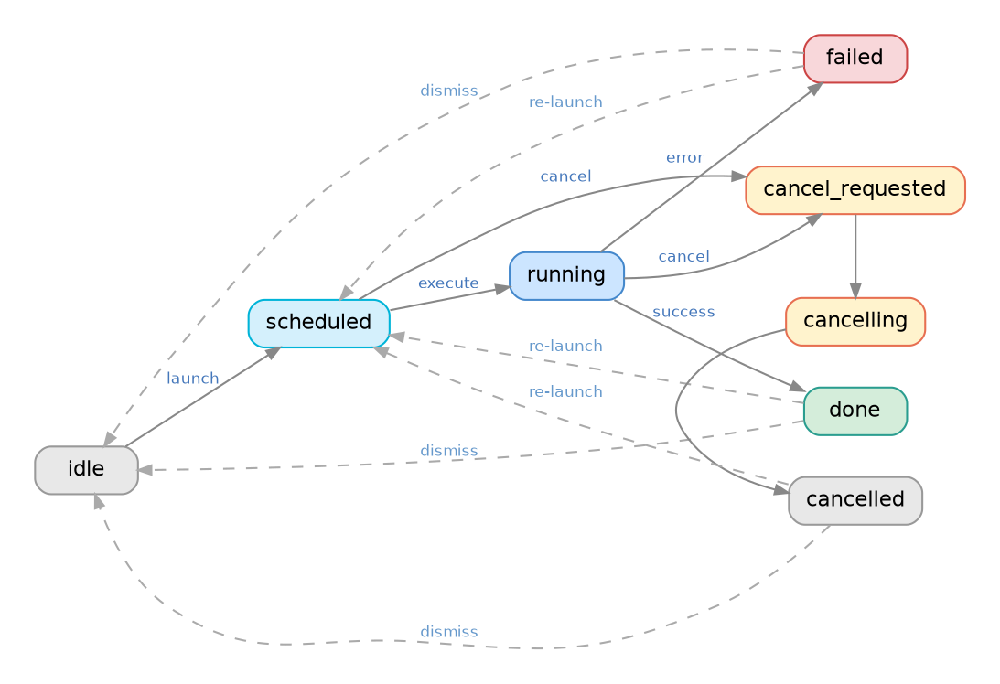

# optio-core

The core Python library for Optio. Embed it in your Python application to define, launch, cancel, and monitor long-running background tasks — with progress reporting, hierarchical child processes, cooperative cancellation, cron scheduling, and ad-hoc dynamic task creation. All backed by MongoDB for persistence. Optional Redis integration enables remote control and custom command handlers.

## Installation

```bash
pip install optio-core
```

For Redis (clamator RPC) support:

```bash
pip install optio-core[redis]
```

**Requirements:** Python 3.11+, MongoDB. Dependencies: `motor>=3.3.0`, `apscheduler>=4.0.0a6`, `mongo-quaestor>=0.1,<0.2`, `clamator-over-redis>=0.1.9`, `clamator-protocol>=0.1.9`, `pydantic>=2.0`, `aiohttp>=3.9`. Redis support: `redis>=5.0.0` (optional extra).

## Quick Start

```python
import asyncio
from motor.motor_asyncio import AsyncIOMotorClient
from optio_core import init, launch_and_wait, get_process, TaskInstance

async def my_task(ctx):
    for i in range(10):
        if not ctx.should_continue():
            return
        ctx.report_progress(i * 10, f"Step {i + 1}/10")
        await asyncio.sleep(1)
    ctx.report_progress(100, "Done")

async def get_tasks(services, metadata_filter=None):
    # Optio filters the result by metadata_filter itself, so it may be ignored.
    return [
        TaskInstance(
            execute=my_task,
            process_id="my-task",
            name="My Task",
        ),
    ]

async def main():
    client = AsyncIOMotorClient("mongodb://localhost:27017")
    db = client["myapp"]

    await init(
        mongo_db=db,
        get_task_definitions=get_tasks,
    )

    await launch_and_wait("my-task", session_id=None)  # no initiating session
    proc = await get_process("my-task")
    print(proc["status"]["state"])  # "done"

asyncio.run(main())
```

## Lifecycle API

All symbols are available directly from `optio_core`:

```python
import optio_core
```

### `init()`

```python
await optio_core.init(
    mongo_db: AsyncIOMotorDatabase,
    prefix: str = "optio",
    redis_url: str | None = None,
    rpc_server: RpcServerCore | None = None,
    services: dict[str, Any] | None = None,
    get_task_definitions: Callable[..., Awaitable[list[TaskInstance]]] | None = None,
    cancel_grace_seconds: float = 5.0,
    auto_resume_delay_seconds: float = 300.0,
    cancel_wait_ceiling_margin_seconds: float = 25.0,
    shutdown_drain_margin_seconds: float = 5.0,
    terminal_poll_interval_seconds: float = 0.1,
    force_cancel_shield_seconds: float = 2.0,
) -> None
```

Initialize Optio. Must be called before any other function.

| Parameter | Type | Default | Description |
|-----------|------|---------|-------------|
| `mongo_db` | `AsyncIOMotorDatabase` | required | Motor async database object |
| `prefix` | `str` | `"optio"` | Namespace for collections (`{prefix}_processes`) and clamator service streams (the `{database}/{prefix}` Redis key prefix). Override if you need to avoid name collisions in a shared database. Streams are automatically scoped by both database name and prefix, so instances using different databases won't collide even on a shared Redis server. |
| `redis_url` | `str \| None` | `None` | If `None` (and no `rpc_server`), Redis features are disabled; use direct method calls only. Mutually exclusive with `rpc_server` |
| `rpc_server` | `RpcServerCore \| None` | `None` | A pre-built clamator RPC server to register the `optio-engine` service on, instead of building one from `redis_url`. The caller owns its start/stop. Mutually exclusive with `redis_url` |
| `services` | `dict[str, Any] \| None` | `{}` | Passed as `ctx.services` to all task execute functions |
| `get_task_definitions` | `Callable[..., Awaitable[list[TaskInstance]]] \| None` | `None` | Async function `(services, metadata_filter) -> list[TaskInstance]`; called on init, when `run()` starts, and on resync. Optio passes both arguments positionally. `metadata_filter` is `None` for a full sync, or a dict of metadata key/value pairs to restrict which task definitions are regenerated; Optio drops the returned tasks that do not match it, so the function may ignore it. **This is the most important part — this is where you declare the tasks that Optio will manage.** See the [TaskInstance definition](#taskinstance) under Data Types. |
| `cancel_grace_seconds` | `float` | `5.0` | How long a cancelled task has to unwind cooperatively before it is force-cancelled and ends `failed` (see [Cooperative Cancellation](#cooperative-cancellation)) |
| `auto_resume_delay_seconds` | `float` | `300.0` | Delay after `run()` starts before the top-level processes of `auto_resume` tasks that the previous shutdown interrupted, and that saved their state, are re-launched with `resume=True` |
| `cancel_wait_ceiling_margin_seconds` | `float` | `25.0` | Added to `cancel_grace_seconds` to give the ceiling after which `Optio.cancel_and_wait()` and `group_cancel_and_wait()` raise `asyncio.TimeoutError` |
| `shutdown_drain_margin_seconds` | `float` | `5.0` | Added to the grace during `shutdown()`'s wait for running processes to exit |
| `terminal_poll_interval_seconds` | `float` | `0.1` | Poll interval while waiting for a process to reach a terminal state |
| `force_cancel_shield_seconds` | `float` | `2.0` | How long a force-cancel waits for the task to unwind after `Task.cancel()` before writing `failed` anyway |

### `run()`

```python
await optio_core.run() -> None
```

Start the main event loop. Blocks until `shutdown()` is called. Starts the cron scheduler, the supervisor that force-cancels processes past their cancel grace, and, if `redis_url` was given, the clamator RPC server (see [Remote Control via Clamator RPC](#remote-control-via-clamator-rpc)). Installs signal handlers for `SIGTERM` and `SIGINT` that trigger graceful shutdown.

Without Redis, `run()` simply blocks until `shutdown()` is called (useful for scheduler-only deployments).

### `shutdown()`

```python
await optio_core.shutdown(grace_seconds: float | None = None) -> None
```

Initiate graceful shutdown. Refuses new launches, stops the RPC server (if Optio built it from `redis_url`), then sets the cancellation flag of every running process, giving each `grace_seconds` (default: `cancel_grace_seconds`) to unwind. It waits up to that grace plus `shutdown_drain_margin_seconds` for them to exit, then force-cancels every process still running; those end `failed`. Finally it closes the Redis connection and unblocks `run()`, which then stops the scheduler.

## State Machine

Every process has a state that follows a strict state machine. The happy path is straightforward:

```
idle --> scheduled --> running --> done
                          |         |
                          v         v
                        failed    idle (dismiss)
                          |
                          v
                        idle (dismiss)

Cancel path:
  scheduled --> cancelled
  running --> cancel_requested --> cancelling --> cancelled
  cancel_requested / cancelling --> failed (force-cancelled after the grace)
  cancelled --> idle (dismiss)
```

Here is the full state diagram, including re-launch and dismiss transitions:



### States

| State | Group | Description |
|-------|-------|-------------|
| `idle` | LAUNCHABLE | Initial state; ready to launch |
| `scheduled` | ACTIVE, CANCELLABLE | Queued by scheduler or launch command |
| `running` | ACTIVE, CANCELLABLE | Execute function is running |
| `cancel_requested` | ACTIVE | Cancel requested, waiting for executor to acknowledge |
| `cancelling` | ACTIVE | Executor acknowledged; cleaning up |
| `done` | END, LAUNCHABLE, DISMISSABLE | Completed successfully |
| `failed` | END, LAUNCHABLE, DISMISSABLE | Execute function raised an exception, or the process was force-cancelled or interrupted by a server restart |
| `cancelled` | END, LAUNCHABLE, DISMISSABLE | Cancelled successfully |

### State Groups

```python
ACTIVE_STATES     = {"scheduled", "running", "cancel_requested", "cancelling"}
END_STATES        = {"done", "failed", "cancelled"}
LAUNCHABLE_STATES = {"idle", "done", "failed", "cancelled"}
CANCELLABLE_STATES = {"scheduled", "running"}
DISMISSABLE_STATES = {"done", "failed", "cancelled"}
```

### Transition Table

| From | To (valid) |
|------|------------|
| `idle` | `scheduled` |
| `scheduled` | `running`, `cancel_requested` |
| `running` | `done`, `failed`, `cancel_requested` |
| `done` | `scheduled`, `idle` |
| `failed` | `scheduled`, `idle` |
| `cancel_requested` | `cancelling` |
| `cancelling` | `cancelled` |
| `cancelled` | `scheduled`, `idle` |

This table is `optio_core.state_machine.VALID_TRANSITIONS`, which optio does not enforce. The engine also writes `scheduled` → `cancelled` (cancel before start), `running` or `cancel_requested` → `cancelled` (the task returned after its flag was set, e.g. during `shutdown()`), and any active state → `failed` (force-cancel after the grace, or a process interrupted by a server restart).

### Cooperative Cancellation

Cancellation is cooperative. When a cancel request arrives:

1. The process state transitions to `cancel_requested`, then `cancelling`.
2. An internal flag is set.
3. The task function must check `ctx.should_continue()` periodically and return early if it returns `False`.
4. Cancellation propagates to active child processes automatically (unless the task sets `auto_cancel_children=False`).

A task that returns while its flag is set ends `cancelled`. A task that has not unwound within `cancel_grace_seconds` (an `init()` parameter, default 5 s) is force-cancelled: `asyncio.CancelledError` is raised in it at its next `await`, and the process ends `failed` with the error `"Task did not unwind within cancellation grace period"`. The force-cancel is done by the supervisor that `run()` starts, and by `shutdown()`.

### Scheduling

Tasks with a `schedule` field are registered with APScheduler as cron jobs. The schedule is a standard cron expression (5 fields: minute, hour, day-of-month, month, day-of-week).

```python
TaskInstance(
    execute=nightly_cleanup,
    process_id="nightly-cleanup",
    name="Nightly Cleanup",
    schedule="0 2 * * *",  # 2:00 AM daily
)
```

Schedules are synced on `init()` and `resync()`. The scheduler starts when `run()` is called.

## ProcessContext

`ProcessContext` is the sole argument to every task execute function. It is the interface your tasks use to communicate with Optio — reporting progress, checking for cancellation, spawning child processes — and also how they receive their injected dependencies and task-specific parameters.

```python
async def execute(ctx: ProcessContext) -> None:
    ...
```

### Properties (read-only) — What the process receives

| Property | Type | Description |
|----------|------|-------------|
| `ctx.process_id` | `str` | The process ID string |
| `ctx.params` | `dict[str, Any]` | Parameters from the task definition. Useful when the same execute function is shared across multiple tasks — for example, a generic data fetcher where each task targets a different source. The source ID (different for each task) is passed in via `params`. |
| `ctx.metadata` | `dict[str, Any]` | Metadata from the task definition. Use this for tagging your processes, which can be useful for finding or identifying them later. |
| `ctx.services` | `dict[str, Any]` | Services dict passed to `init()`. Use this for dependency injection. |

### Methods — What the process can do

#### `report_progress()`

```python
ctx.report_progress(percent: float | None, message: str | None = None, *, level: Literal["info", "warning"] = "info") -> None
```

Update progress. `percent` is 0-100, or `None` for indeterminate progress. `message` is an optional description of the current step (also appended to the process log). `level` (keyword-only, `"info"` or `"warning"`) is the log level of that line; warnings are never dropped when a burst of messages is coalesced, so they are not rate-limited either. Progress writes are buffered and flushed to MongoDB at most every 100ms (configurable via the `OPTIO_PROGRESS_FLUSH_INTERVAL_MS` environment variable). A final flush occurs automatically when the process completes.

#### `should_continue()`

```python
ctx.should_continue() -> bool
```

Returns `False` when cancellation has been requested. Poll this in loops to support cooperative cancellation.

#### `mark_ephemeral()`

```python
await ctx.mark_ephemeral() -> None
```

Mark this process for deletion after it completes (reaches a terminal state).

#### `run_child()`

```python
await ctx.run_child(
    execute: Callable[..., Awaitable[None]],
    process_id: str,
    name: str,
    params: dict[str, Any] | None = None,
    survive_failure: bool = False,
    survive_cancel: bool = False,
    on_child_progress: Callable[[list[ChildProgressInfo]], None] | None = None,
    description: str | None = None,
) -> ChildOutcome
```

Run a sequential child process. Blocks until the child completes. Returns a `ChildOutcome` (`from optio_core.models import ChildOutcome`): `.state` is the child's final state, `"done"`, `"failed"`, or `"cancelled"`, and `.original_exception` the exception a failed child raised.

| Parameter | Type | Default | Description |
|-----------|------|---------|-------------|
| `execute` | `Callable` | required | Async function for the child task |
| `process_id` | `str` | required | Unique ID for the child process |
| `name` | `str` | required | Display name |
| `description` | `str \| None` | `None` | Optional description text |
| `params` | `dict \| None` | `None` | Parameters passed to the child's `ctx.params` |
| `survive_failure` | `bool` | `False` | If `False`, raises `ChildProcessFailed` (`from optio_core.exceptions import ChildProcessFailed`; `.original` is the child's exception) when the child fails |
| `survive_cancel` | `bool` | `False` | If `False`, a cancelled child cancels the parent too: the parent's `should_continue()` turns `False`. No exception is raised |
| `on_child_progress` | `Callable \| None` | `None` | Callback for child progress updates (use progress helpers) |

#### `parallel_group()`

```python
ctx.parallel_group(
    max_concurrency: int = 10,
    survive_failure: bool = False,
    survive_cancel: bool = False,
    on_child_progress: Callable[[list[ChildProgressInfo]], None] | None = None,
) -> ParallelGroup
```

Create a parallel execution group. Use as an async context manager.

| Parameter | Type | Default | Description |
|-----------|------|---------|-------------|
| `max_concurrency` | `int` | `10` | Maximum number of children running concurrently |
| `survive_failure` | `bool` | `False` | If `False`, raises `ExceptionGroup` of `ChildProcessFailed` on exit if any child failed |
| `survive_cancel` | `bool` | `False` | If `False`, cancels the parent and raises `ExceptionGroup` of `ChildProcessFailed` on exit if any child was cancelled |
| `on_child_progress` | `Callable \| None` | `None` | Callback for child progress updates |

Inside the context, call `await group.spawn(execute, process_id, name, params, description)` to add children. After the context exits, `group.results` contains a `list[ChildResult]`.

## Child Processes

Tasks can spawn child processes that appear as a tree in the database. Children have their own state, progress, and logs.

### Sequential Children

```python
async def parent_task(ctx):
    ctx.report_progress(0, "Starting phase 1")
    outcome = await ctx.run_child(
        execute=phase_one,
        process_id=f"{ctx.process_id}/phase-1",
        name="Phase 1",
        params={"key": "value"},
        survive_failure=False,  # Raise ChildProcessFailed if child fails (default)
        survive_cancel=False,   # Cancel this task too if child is cancelled (default)
    )
    # outcome.state is "done" or "cancelled" here (a failure raised ChildProcessFailed)

    ctx.report_progress(50, "Starting phase 2")
    await ctx.run_child(
        execute=phase_two,
        process_id=f"{ctx.process_id}/phase-2",
        name="Phase 2",
    )
    ctx.report_progress(100, "Complete")
```

### Parallel Children

```python
async def parent_task(ctx):
    async with ctx.parallel_group(
        max_concurrency=5,
        survive_failure=True,   # Continue even if some children fail
        survive_cancel=False,
    ) as group:
        for i, item in enumerate(items):
            await group.spawn(
                execute=process_item,
                process_id=f"{ctx.process_id}/item-{i}",
                name=f"Process {item['name']}",
                params={"item": item},
            )

    # group.results is a list of ChildResult after the group completes
    failed = [r for r in group.results if r.state != "done"]
    ctx.report_progress(100, f"Done, {len(failed)} failures")
```

When `survive_failure=False` (the default), an `ExceptionGroup` of `ChildProcessFailed` is raised when the group's async context exits if any child failed; with `survive_cancel=False` (the default), also if any child was cancelled. Catch it with `except* ChildProcessFailed`.

## Progress Reporting

Call `ctx.report_progress(percent, message)` from your task function:

- `percent`: `float` from 0 to 100, or `None` for indeterminate progress.
- `message`: Optional `str` describing the current step. Also appended to the process log.
- `level`: Keyword-only, `"info"` (default) or `"warning"`: the log level of that line. Warnings are never dropped by burst coalescing, and are not rate-limited, so do not emit one per line of a stream.

Progress writes are buffered and flushed to MongoDB at most every 100ms (configurable via `OPTIO_PROGRESS_FLUSH_INTERVAL_MS`). A final flush occurs automatically when the process completes.

### Progress Helpers

Import from `optio_core.progress_helpers`:

```python
from optio_core.progress_helpers import sequential_progress, average_progress, mapped_progress
```

These return `on_child_progress` callbacks suitable for `run_child()` and `parallel_group()`.

#### `sequential_progress(ctx, total_children)`

Divides parent 0-100% into equal slots for N sequential children. Each child's 0-100% maps to its `100/N`% slot of the parent.

#### `average_progress(ctx)`

Parent percent = average of all children's percent. Children in terminal states (`done`, `failed`, `cancelled`) count as 100%.

#### `mapped_progress(ctx, range_start, range_end)`

Maps a single child's 0-100% into a sub-range of the parent. Arguments are fractions from 0.0 to 1.0.

```python
# Child's progress maps to 0-25% of parent
on_progress = mapped_progress(ctx, 0.0, 0.25)
await ctx.run_child(execute=step_one, process_id="step-1", name="Step 1",
                    on_child_progress=on_progress)
```

## Process Management

Now that we have discussed what the individual processes can do, let's look at what the application can do to the processes.

### `launch()`

```python
await optio_core.launch(
    process_id: str, resume: bool = False, *, session_id: str | None,
) -> LaunchOutcome
```

Fire-and-forget launch. The process begins execution in a background task and the call returns immediately. The process must be in a launchable state (`idle`, `done`, `failed`, or `cancelled`). `session_id` is required (keyword-only): the id of the session that initiated the launch, or `None` for an unattended launch; it is stored on the process as `originatingSessionId`. `resume=True` starts the task with `ctx.resume=True` (the task needs `supports_resume=True`; without saved state it starts fresh). Returns a `LaunchOutcome`: `ok=True` with `proc` the process document, or `ok=False` with a `reason`: `not-found`, `not-launchable`, `launch-blocked`, `no-resume-support` or `shutting-down`.

### `launch_and_wait()`

```python
await optio_core.launch_and_wait(
    process_id: str, resume: bool = False, *, session_id: str | None,
) -> None
```

Launch a process and block until it reaches a terminal state (`done`, `failed`, or `cancelled`). Useful for scripting and tests. `session_id` is as for `launch()`; `resume` reaches the task as `ctx.resume` unchecked (no `supports_resume` or saved-state check). Raises `LaunchBlocked` if a launch block matches the task's metadata. If the process is not found or not in a launchable state, it returns at once without launching.

### `cancel()`

```python
await optio_core.cancel(process_id: str) -> CancelOutcome
```

Cancel a running or scheduled process. If `scheduled`, it transitions directly to `cancelled`. If `running`, it transitions through `cancel_requested` -> `cancelling`, and the cancellation flag is set for cooperative cancellation. Returns a `CancelOutcome`: `ok=True` with `proc` the process document, or `ok=False` with `reason` `not-found` or `not-cancellable` (not `scheduled` or `running`, or the task has `cancellable=False`).

### `dismiss()`

```python
await optio_core.dismiss(process_id: str) -> DismissOutcome
```

Reset a completed process back to `idle`. Only works on processes in a dismissable state (`done`, `failed`, or `cancelled`). Clears the previous run's result fields (status timestamps, progress, logs) and deletes all descendant child processes. Returns a `DismissOutcome`: `ok=True` with `proc` the process document, or `ok=False` with `reason` `not-found` or `not-dismissable`.

### `resync()`

```python
await optio_core.resync(
    clean: bool = False,
    metadata_filter: ProcessMetadataFilter | None = None,
) -> dict[str, str]
```

Re-run the task generator and sync definitions with the database. New tasks are created, the root records of tasks no longer generated are deleted (an active one is cancelled first, waiting up to `cancel_grace_seconds`), and metadata on existing tasks is updated without disturbing runtime state. Returns a `{processId: oid_hex}` map of the tasks synced.

| Parameter | Type | Default | Description |
|-----------|------|---------|-------------|
| `clean` | `bool` | `False` | If `True`, delete process records before re-syncing: all of them, or with `metadata_filter` the matching root records |
| `metadata_filter` | `dict[str, Any] \| None` | `None` | If set, only tasks whose metadata matches are regenerated and pruned; everything else is left alone |

## Querying

### `get_process()`

```python
await optio_core.get_process(process_id: str) -> dict | None
```

Get a single process document by its `processId` string. Returns the full MongoDB document or `None` if not found.

### `list_processes()`

```python
await optio_core.list_processes(
    state: str | None = None,
    root_id: str | None = None,
    metadata: dict[str, str] | None = None,
) -> list[dict]
```

List processes with optional filters. Results are sorted by `depth`, `order`, then `_id`.

| Parameter | Type | Default | Description |
|-----------|------|---------|-------------|
| `state` | `str \| None` | `None` | Filter by `status.state` (e.g., `"running"`, `"done"`) |
| `root_id` | `str \| None` | `None` | Filter by `rootId` (string; converted to ObjectId internally) |
| `metadata` | `dict[str, str] \| None` | `None` | Filter by metadata fields. Each key-value pair matches against `metadata.{key}` in the process document. Multiple entries are combined with AND. For example, `metadata={"customer": "2"}` returns all processes tagged with that customer. |

### `count_processes()`

```python
await optio_core.count_processes(
    *,
    states: Collection[str] | None = None,
    metadata: dict[str, str | list[str]] | None = None,
    roots_only: bool = False,
) -> int
```

Count processes matching the filters without loading their documents (a
`count_documents` query). Useful for frequent checks such as "how many syncs of
this source are active".

| Parameter | Type | Default | Description |
|-----------|------|---------|-------------|
| `states` | `Collection[str] \| None` | `None` | The process is in any of these states, e.g. `ACTIVE_STATES` |
| `metadata` | `dict[str, str \| list[str]] \| None` | `None` | Each key-value pair matches `metadata.{key}`, combined with AND. A list value matches any of its items: `{"kind": ["sync", "sync-dry"]}` |
| `roots_only` | `bool` | `False` | Count top-level processes only. Children inherit their parent's metadata, so without it a running parent counts once per matching child |

## Ad-hoc Processes

Ad-hoc processes are created at runtime rather than from the task generator. They are useful for one-off operations or dynamically spawned work.

### `adhoc_define()`

```python
await optio_core.adhoc_define(
    task: TaskInstance,
    parent_id: ObjectId | None = None,
    ephemeral: bool = False,
) -> dict
```

Create an ad-hoc process at runtime. Returns the MongoDB process document. The process starts in `idle` state.

| Parameter | Type | Default | Description |
|-----------|------|---------|-------------|
| `task` | `TaskInstance` | required | Task instance with execute function, process_id, name, etc. |
| `parent_id` | `ObjectId \| None` | `None` | If set, creates the process as a child of the given parent (by MongoDB `_id`) |
| `ephemeral` | `bool` | `False` | If `True`, the process is automatically deleted after reaching a terminal state |

### `adhoc_delete()`

```python
await optio_core.adhoc_delete(process_id: str) -> None
```

Delete an ad-hoc process and all its descendants from MongoDB. Also removes it from the internal task registry.

**Example:**

```python
from optio_core import adhoc_define, launch, TaskInstance

proc = await adhoc_define(
    task=TaskInstance(
        execute=one_off_task,
        process_id="one-off-123",
        name="One-off Import",
    ),
    ephemeral=True,  # Auto-delete after completion
)

await launch("one-off-123", session_id=None)
```

## Remote Control via Clamator RPC

When Redis is configured (by passing `redis_url` to `init()`), `optio-core`
hosts a clamator `RedisRpcServer` at the `${database}/${prefix}` key prefix
and registers the `optio-engine` service against it. External services
control processes by holding a clamator client and calling typed methods:
`launch`, `cancel`, `dismiss`, `resurrect`, `resync`, `group_cancel`, `group_cancel_and_wait`,
`block_launches`, `unblock_launches`, `materialize_upload`. Results are discriminated unions —
`ok: true` carries the updated process payload; `ok: false` carries a typed
`reason` field (e.g. `"not-found"`, `"not-cancellable"`, `"launch-blocked"`,
`"no-resume-support"`).

The contract lives in `packages/optio-contracts/src/optio-engine-to-api.ts`.
Generated TypeScript bindings ship from `optio-api` / `optio-contracts`;
the Python ABC and Pydantic models are codegenned to
`src/optio_core/_generated/optio_engine.py` (filename post-processed from
`optio-engine.py` so Python's module-identifier rules accept it).

The RPC server is exposed at `optio_core.rpc_server` for applications that
need to register additional services on the same server before calling
`optio_core.run()`:

```python
import optio_core

await optio_core.init(mongo_db=db, redis_url=URL, prefix='myapp')
optio_core.rpc_server.register_service(my_domain_contract, MyDomainService())
await optio_core.run()
```

Custom command verbs are added by registering an additional clamator
service against `optio_core.rpc_server`.

## Data Types

### `TaskInstance`

```python
@dataclass
class TaskInstance:
    execute: Callable[..., Awaitable[None]]  # async def execute(ctx: ProcessContext) -> None
    process_id: str
    name: str
    description: str | None = None           # optional description, shown as tooltip in UI
    params: dict[str, Any] = field(default_factory=dict)
    metadata: dict[str, Any] = field(default_factory=dict)
    schedule: str | None = None              # cron expression, e.g. "0 3 * * *"
    special: bool = False                    # hidden from default UI views when special=True
    warning: str | None = None               # shown as confirmation prompt before launch
    cancellable: bool = True                 # whether this process can be cancelled
    ui_widget: str | None = None             # optio-ui widget that renders this process
    supports_resume: bool = False            # the task can resume from saved state
    ttl_seconds: int | None = None           # delete the record this long after it ends
    auto_cancel_children: bool = True        # cancel propagates to active children
    auto_resume: bool = False                # resume after an engine restart
    resurrect: Callable[..., Awaitable[None]] | None = None  # saves a failed run's work
    schedule_offset_seconds: int | None = None  # second within the minute at which `schedule` fires
    session_crypto: SessionCrypto | None = None  # at-rest cipher for the task's blobs
    read_conversation: Callable[..., Awaitable[list | dict | None]] | None = None
```

| Field | Type | Description |
|-------|------|-------------|
| `execute` | `Callable[..., Awaitable[None]]` | Async function `(ctx: ProcessContext) -> None` that implements the task |
| `process_id` | `str` | Unique string identifier for this process |
| `name` | `str` | Human-readable display name |
| `description` | `str \| None` | Optional description text, shown as tooltip on process name in the UI |
| `params` | `dict[str, Any]` | Parameters passed to the execute function via `ctx.params` |
| `metadata` | `dict[str, Any]` | Application metadata stored on the process document. Use this for tagging processes so you can find them later — e.g., `{"customer": "2"}` to associate a task with a specific customer. See `list_processes(metadata=...)` for querying. |
| `schedule` | `str \| None` | Cron expression (5 fields) for automatic scheduling, or `None` |
| `special` | `bool` | Hidden from default UI views when `True` |
| `warning` | `str \| None` | Warning message shown as confirmation prompt before launch |
| `cancellable` | `bool` | Whether this process can be cancelled (default: `True`) |
| `ui_widget` | `str \| None` | Name of a widget registered in optio-ui (`registerWidget()`) that renders this process instead of the default tree+log view. Stored as `uiWidget` |
| `supports_resume` | `bool` | The task can restore saved state when launched with `resume=True` (default: `False`). Stored as `supportsResume`; see `ctx.mark_has_saved_state()` in [AGENTS.md](AGENTS.md) |
| `ttl_seconds` | `int \| None` | If set, the record is deleted by MongoDB's TTL index this many seconds after the process reaches a terminal state; children use their parent's value |
| `auto_cancel_children` | `bool` | When `True` (default), cancelling this process also cancels its active direct children; when `False`, the task cancels its own children (if it is still running at the end of the grace, it and its live descendants are force-cancelled) |
| `auto_resume` | `bool` | A top-level process interrupted by an engine shutdown that saved its state is re-launched with `resume=True` after the next start, `auto_resume_delay_seconds` later (default: `False`). Requires `supports_resume=True` |
| `resurrect` | `Callable \| None` | Optional hook that saves the work a failed run left on its host; run by `optio_core.resurrect()`, followed by a resume. Requires `supports_resume=True` |
| `schedule_offset_seconds` | `int \| None` | Second (0–59) within each matching minute at which `schedule` fires; `None` fires at second 0. Use it to spread many minute-aligned schedules across the minute. |
| `session_crypto` | `SessionCrypto \| None` | The task's at-rest cipher (`encrypt` / `decrypt` callables) for its own encrypted blobs; `None` means no encryption |
| `read_conversation` | `Callable \| None` | Optional hook returning the conversation record a suspended process saved, for a read-only view without resuming it |

The fields after `cancellable` are covered in more detail in [AGENTS.md](AGENTS.md).

### `ChildResult`

```python
@dataclass
class ChildResult:
    process_id: str
    state: str        # "done" | "failed" | "cancelled"
    error: str | None = None
    name: str = ""
    original_exception: BaseException | None = None  # what a failed child raised
```

Returned in `ParallelGroup.results` after all children complete.

### `ChildProgressInfo`

```python
@dataclass
class ChildProgressInfo:
    process_id: str
    name: str
    state: str             # "scheduled" | "running" | "done" | "failed" | "cancelled"
    percent: float | None = None
    message: str | None = None
```

Passed to `on_child_progress` callbacks. Contains the current state and progress of each child in a group.

## MongoDB Document Schema

Optio-core is the sole owner of the data in MongoDB — external code should treat these documents as read-only. If you need to observe process state from other services or a frontend, use [optio-api](../optio-api/README.md), which exposes this data as a REST API with SSE streams for real-time updates.

Collection: `{prefix}_processes`

| Field | Type | Description |
|-------|------|-------------|
| `_id` | ObjectId | MongoDB document ID |
| `processId` | string | Application-defined unique identifier |
| `name` | string | Human-readable display name |
| `description` | string \| null | Optional description text |
| `params` | object | Static parameters from TaskInstance |
| `metadata` | object | Arbitrary metadata; fields can be filtered via `list_processes(metadata=...)` |
| `parentId` | ObjectId \| null | Parent process `_id`; null for root processes |
| `rootId` | ObjectId | Root process `_id`; equals `_id` for root processes |
| `depth` | int | Tree depth; 0 for root |
| `order` | int | Sort order among siblings |
| `cancellable` | bool | Whether cancel is permitted |
| `adhoc` | bool | True if created via `adhoc_define()` |
| `ephemeral` | bool | True if process should be deleted after completion |
| `special` | bool | Marks administrative/special-purpose processes |
| `warning` | string \| null | Warning text shown before launch |
| `status` | object | Runtime status sub-document |
| `status.state` | string | Current process state |
| `status.error` | string \| null | Error message (failed state) |
| `status.runningSince` | datetime \| null | When execution started |
| `status.doneAt` | datetime \| null | When process completed successfully |
| `status.duration` | float \| null | Execution duration in seconds |
| `status.failedAt` | datetime \| null | When process failed |
| `status.stoppedAt` | datetime \| null | When process was cancelled |
| `progress` | object | Progress sub-document |
| `progress.percent` | float \| null | 0-100, or null for indeterminate |
| `progress.message` | string \| null | Current progress message |
| `log` | array | Log entries from the current/last run |
| `log[].timestamp` | ISO datetime string | Entry timestamp |
| `log[].level` | string | `event` \| `info` \| `debug` \| `warning` \| `error` |
| `log[].message` | string | Log message |
| `log[].data` | object \| absent | Optional structured data |
| `createdAt` | datetime | Document creation timestamp |

## Configuration

| Environment Variable | Default | Description |
|---------------------|---------|-------------|
| `OPTIO_PROGRESS_FLUSH_INTERVAL_MS` | `100` | How often (in milliseconds) buffered progress updates are flushed to MongoDB |

## See Also

- [Optio Overview](../../README.md)
- [How to set up a new optio app](../../docs/how-to-set-up-a-new-optio-app.md): an engine, API server and UI built on optio-core, step by step
